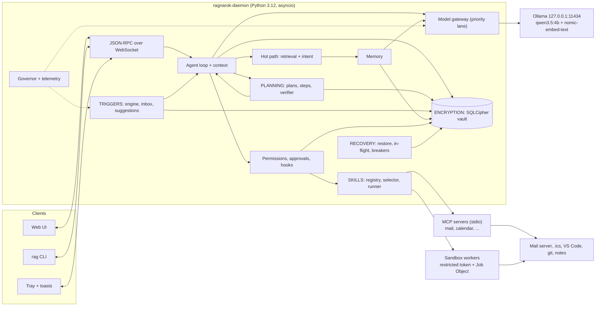

# Ragnarok — Architecture

> A local, always-on personal agent, built the way Claude Code and Codex are built: a model in a
> tool-calling loop, permission rules and approvals, a sandbox, and resumable session logs.
> It runs entirely on one Windows laptop, with Ollama on `127.0.0.1`.

| | |
|---|---|
| Status | Design v2 (2026-10-25), **updated 2026-10-26 with what was built**: see section 0.1. Sections 2-12 still describe the original design; where the build differs, 0.1 and the dated notes in sections 5.4, 7.3 and 9.1 say so. Measured numbers: `docs/REQUIREMENTS.md`. |
| Requirements | the hackathon brief (FR1–FR4, NFR1–NFR4), not included in the repository; tracked item by item in `docs/REQUIREMENTS.md` |
| Focus | The five things the PDF stresses: **skills, planning, triggers, encryption, recovery** |
| Related | `AGENTS.md` (project context) · `docs/DECISIONS.md` (why) · `docs/WORKLOG.md` (what happened) · `docs/history/` (earlier versions) |

---

## 0. Summary

Ragnarok is a background daemon that runs an agent harness over your day: mail, calendar, files,
notes, and code. The design is built around five pillars; everything else supports them.

| Pillar | PDF | In one line |
|---|---|---|
| **Skills** | FR2.1–2.3 | Skills are `SKILL.md` folders with scripts, or MCP servers. Each is registered with tests and declared permissions, chosen per request by embedding search, and run in a Windows sandbox. |
| **Planning** | FR3.1–3.3 | The model writes a plan whose steps declare dependencies. Each step runs as a small focused sub-agent and is verified. Failures are retried, then fixed, then re-planned, and independent steps keep going. |
| **Triggers** | FR4.1–4.2 | Cron, folder, mail, and calendar triggers start headless sessions in a read-only profile. Side effects wait in an Inbox, and proactive suggestions arrive as Windows notifications. |
| **Encryption** | NFR1.1–1.3 | All user data lives in one SQLCipher vault whose key is protected by your passphrase. Ollama runs in local-only mode and the gateway talks only to loopback. |
| **Recovery** | NFR3.1–3.2 | Everything is an event in the vault, and tool calls are logged before they run. Idempotency keys prevent double side effects, and a restart replays to the exact state in under 5 s. |

**What the judges see:**
- A real multi-app goal runs live, from mail to calendar to a code fix.
- The plan graph shows steps retrying and recovering.
- The daemon is killed mid-plan, resumes in under a second, and creates no duplicate event.
- A malicious skill is blocked by the sandbox.
- A Proof panel shows a live measured value next to every NFR.

| Runtime choice | |
|---|---|
| Processes | `ragnarok-daemon` (Python 3.12, asyncio) + `ollama serve` + thin clients (web UI, `rag` CLI) |
| Chat model | `qwen3.5:4b` (Q4_K_M, 3.3 GB): the only chat model, always resident on the RTX 4050 |
| Embeddings | `nomic-embed-text` (768-d), also resident |
| Storage | One SQLCipher file in `%LOCALAPPDATA%\Ragnarok\` (outside OneDrive) |
| Not used | Docker, WSL, Electron, Redis, Postgres, vector-DB servers, any cloud API |

### 0.1 Built versus designed (2026-10-26)

| Area | Designed | Built | Difference and why |
|---|---|---|---|
| Processes | daemon + web UI + `rag` CLI | the chat or the pixel cat holds the runtime; `rag daemon` is an optional second process | No web server: the cat (tkinter) and the terminal replaced the web UI and Proof panel (D-044) |
| Skills | `SKILL.md` + YAML, plus MCP servers | `SKILL.md` + `skill.json`, registered with tests, approval and a content hash (D-047) | No YAML library installed and no new dependency allowed without a decision; no MCP servers built |
| Sandbox | restricted token + Job Object + offline + audit hook | Job Object (memory and process caps, kill on close) + scrubbed environment + audit hook + narrow I/O | **No restricted token and no firewall rule**, so "offline" is by environment and hook. Built-in tools are not sandboxed; they use path guards and approvals |
| Planning | sub-agent per step, typed verifier, failure ladder | as designed, sequential steps (D-043) | `done_when` checks only where reliable |
| Triggers | cron, folder, mail, calendar | date, cron, folder, mailbox-folder (`.eml`) | No calendar trigger; the folder watcher polls (no `watchdog`) |
| Suggestions | generators + model-written text, toasts | rule-based, no model call (D-049) | Four patterns; fixed wording |
| Daemon | Task Scheduler task, restart on failure | `rag daemon` with a lock file and heartbeat; `--startup on` puts a launcher in the Startup folder | Simpler; hidden start needs the DPAPI unlock opt-in |
| Recovery | snapshots, replay, idempotency keys, in-flight resolution | `restore_state` over the event log and plan tables; cut-off calls closed and flagged (D-048) | No snapshots (replay is milliseconds); `/resume` asks before repeating a non-idempotent call |
| Mail, calendar, editor | mail/calendar MCP servers, VS Code | local `.eml` mailbox folder; Gmail through the user's browser, which can write **and send** by finding and clicking the Send button (D-050, D-052); `open_in_editor` for VS Code | No stored account password; no calendar; no IMAP |
| Permissions | profiles, allow/ask/deny, hooks | profiles + modes + roles (D-051); sending mail always asks | No hooks |
| Explainability | decision trace, Proof panel | `/log`, `/log plan`, `rag log` | No Proof panel |
| Memory | FR1 design in `docs/MEMORY.md` | milestones M0-M5 built | Turbovec exact-search default (D-026) |

---

## 1. Target machine

Probed on 2026-10-25:

| | |
|---|---|
| Laptop | HP OMEN 16 (wd0xxx), Windows 11 Home |
| CPU | Intel Core i5-13420H, 8 cores / 12 threads |
| RAM | 15.7 GB |
| GPU | NVIDIA RTX 4050 Laptop, **6 GB VRAM** (driver 592.82) + Intel UHD iGPU |
| Disk | 65 GB free on C: |
| Installed | Python 3.13 (Microsoft Store build), Node 24, Git |
| Missing | Ollama, uv, WSL, Docker |

What this forces:

- **One 4B chat model.** It fits fully in 6 GB alongside its KV cache and the embedder.
  `qwen3.5:9b` (6.6 GB) and `qwen3:8b` (5.2 GB) would spill onto the CPU and run several times slower.
- **A native Windows sandbox.** There is no WSL or Docker, and Docker Desktop would use 2–4 GB of the 16 GB RAM anyway.
- **Python 3.12 via uv**, not the Store build of 3.13. Windows py3.12 wheels are confirmed for
  `sqlcipher3`, `apsw-sqlite3mc`, `pywin32`, `mcp`, `pystray`, and `windows-toasts`.
- **Hybrid graphics mode** (Optimus): the desktop runs on the Intel iGPU, so the 4050's VRAM stays free.
  nvidia-smi showed 0 MiB used.
- **Runtime data outside OneDrive.** The project folder is under `OneDrive\Desktop`, so all runtime data goes to
  `%LOCALAPPDATA%\Ragnarok\` and is never synced.

Budgets (estimates; `ollama ps` must show `100% GPU`):

| VRAM (6 GB) | |
|---|---|
| `qwen3.5:4b` Q4_K_M | ~3.3 GB |
| KV cache at 16k context, `q8_0` | ~0.5–1.0 GB (architecture-dependent, measure) |
| `nomic-embed-text` | ~0.3 GB |
| Headroom | ~1 GB |

If `ollama ps` shows any CPU share, drop `num_ctx` to 8192.

RAM budget: the daemon gets ≤ 500 MB, the UI tab about 300 MB, and each sandboxed tool is capped at 1 GB by its Job Object.

---

## 2. Runtime: the harness the pillars plug into

### 2.1 Components



| Process | Role | Lifetime |
|---|---|---|
| `ragnarok-daemon` | API, agent loop, the five pillars, memory, governor | always on, started at login by Task Scheduler |
| `ollama serve` | models on the GPU | always on |
| sandbox workers | one per tool or script execution | per call |
| MCP servers | stdio tool servers | started on first use, kept warm |
| Web UI / `rag` | thin clients | while open |

### 2.2 Agent loop

```python
async def run_turn(session, text):
    await session.log("user_message", text=text)
    hot = await hot_path(text)                    # retrieval + intent + tool top-k (NFR2.1, §2.4)
    if hot.intent == "multi_step":
        return await planning.run(session, text, hot)          # §4
    ctx = context.build(session, hot)             # stable prefix first, tool set frozen for the turn
    for _ in range(MAX_STEPS):
        reply = await gateway.chat(ctx, priority=INTERACTIVE, stream_to=session.clients)
        await session.log("assistant_message", reply)
        if not reply.tool_calls:
            return reply.text
        results = await tools.run_batch(session, reply.tool_calls)  # read-only in parallel, writes in order
        ctx = context.append(ctx, reply, results)                   # compacts near the limit

async def run_tool(session, call):
    decision = permissions.check(session.profile, call)        # deny > ask > allow
    if decision.ask:
        decision = await approvals.wait(session, call, decision)
    if not decision.allowed:
        return session.result(call, denied=decision.reason)
    await hooks.pre_tool(call)
    await session.log("tool_call", call, durable=True)          # logged before side effects (§7.2)
    result = await skills.execute(call, sandbox=decision.sandbox)
    await session.log("tool_result", call.id, result)
    await hooks.post_tool(call, result)
    return result
```

This is the shape Claude Code and Codex use: the model proposes tool calls, the harness checks
permissions, runs them, appends the results, and loops. Loop rules:

- **Truncation:** tool output over 2,000 tokens is cut, with a note on how to page through the rest (`read(path, offset)`).
- **Loop guard:** the same call with the same arguments three times stops the loop and asks the user.
- **Step caps:** 12 per interactive turn and 25 per headless run.
- **Cancel:** aborts the Ollama stream and kills the sandbox job by closing its Job Object.

### 2.3 Model gateway

- It talks only to `http://127.0.0.1:11434` and rejects model names ending in `-cloud`.
- **One priority lane:** INTERACTIVE > STEP > BACKGROUND. When a user turn arrives, the in-flight background
  request is cancelled and its job requeued, so the user never waits behind background work.
- **Load options never change** (model, `num_ctx`). A changed load option makes Ollama reload the model,
  which is seconds of lag.
- Every response's `prompt_eval_count`, `eval_count`, and durations are recorded, which gives tok/s and shows prompt-cache hits.

| Call | `think` | `num_predict` | Output |
|---|---|---|---|
| Interactive turn | off | 1024 | native tool calls / text |
| `update_plan` | off (deep mode: on) | 512 | JSON schema |
| Verify step | off | 48 | JSON `{pass, reason}` |
| Intent fallback | off | 16 | JSON enum |
| Memory extraction / compaction | off | 384 | JSON / text |

Plan, verify, and extract calls use `temperature` 0 with a fixed `seed`, so demos are reproducible. Chat uses 0.3.

### 2.4 Hot path: retrieval + intent (NFR2.1)

This runs before any model call. The target is p95 < 800 ms; we expect well under 200 ms on this GPU.

1. Embed the message with the `search_query:` prefix: 10–40 ms.
2. In parallel, run FTS5 BM25 for exact strings (error codes, filenames, ports) and cosine similarity over the in-RAM vector matrix: < 10 ms.
3. Combine the results with Reciprocal Rank Fusion (`k = 60`). Boost recent items only when the message has time words, and drop archived or deleted items.
4. Pick the top-k tools from the same vector: < 5 ms.
5. Classify the intent as `chat | direct_tool | multi_step | memory_admin`, using the nearest labelled examples
   (`config/intents.yaml`, ~15 per intent) plus simple rules. Only low confidence costs a model call, which is constrained to ≤ 16 tokens.

Vector search uses **Turbovec** (TurboQuant quantization) in RAM, rebuilt from the encrypted embeddings at startup.
Exact numpy search over float32 (10k × 768 × 4 B ≈ 31 MB) is the fallback and the quality baseline (D-019).
The full memory design is in `docs/MEMORY.md`.

---

## 3. Pillar 1 — Skills (FR2)

### 3.1 What a skill is

There are three sources and one interface. **Everything executable is a tool** with a name, a description,
an input JSON Schema, an optional output schema, `risk`, `idempotent`, `timeout`, `sandbox`, and declared `fs`/`network` needs.

| Kind | Looks like | Good for | Examples |
|---|---|---|---|
| Script skill | folder: `SKILL.md` + `scripts/` | Python scripts, CLI commands, multi-step procedures | `file-invoice`, `fix-failing-test` |
| MCP skill | MCP server over stdio, listed in `config/mcp.json` | API wrappers, app integrations | our `mail` and `calendar`; community `git`, `filesystem` |
| Built-in tool | Python function in the daemon | primitives | `read`, `edit`, `shell`, `memory_search`, `update_plan`, `schedule`, `notify` |

`SKILL.md` uses the Claude Code Agent Skills frontmatter (`name`, `description`, `allowed-tools`) plus
markdown instructions, so skills stay portable. Ragnarok-specific fields sit under a `ragnarok:` key.
`mcp.json` has the same shape as Claude Code's `.mcp.json`.

Risk tiers: **R0** read-only · **R1** local, reversible write · **R2** external or hard to undo · **R3** destructive.

### 3.2 Anatomy of a script skill

```markdown
---
name: file-invoice
description: File an invoice PDF under ~/Documents/Invoices/<vendor>/ and set a payment reminder.
  Use when a new invoice PDF appears or the user asks to file one.
allowed-tools: [invoice_extract, move_file, schedule, notify]
ragnarok:
  version: 1.2.0
  risk: R1
  tools:
    - name: invoice_extract
      run: ["python", "scripts/extract.py"]      # JSON args on stdin, JSON result on stdout
      input:  {type: object, required: [pdf], properties: {pdf: {type: string}}}
      output: {type: object, required: [vendor, amount, due_date]}
      sandbox: read-only
      fs: {read: ["$args.pdf"]}
      network: []
      timeout_s: 20
      idempotent: true
  tests:
    - tool: invoice_extract
      args: {pdf: "fixtures/invoices/acme-oct.pdf"}
      expect: {vendor: "ACME", amount: 4200}
---
1. Call `invoice_extract` on the PDF.
2. Move it to `~/Documents/Invoices/<vendor>/<yyyy-mm>-<amount>.pdf` with `move_file`.
3. Create a reminder two days before `due_date` with `schedule`.
4. Reply in one line: vendor, amount, due date, where it was filed.
```

**Script contract:** JSON args arrive on stdin, the JSON result goes to stdout, logs go to stderr, and exit code 0 means success.
CLI tools use argv templates (`["git", "log", "-n", "{n}"]`) filled from validated arguments. There is never a
shell string, so arguments can't inject commands.

### 3.3 Registering and managing skills (FR2.1)

```text
rag skill add ./skills/file-invoice          # or a git URL
rag skill test file-invoice
rag skill list | show | disable | remove
rag mcp add git -- uvx mcp-server-git
rag mcp tools git                            # tools + their risk tiers
```

The registration pipeline:

1. Validate the manifest against the skill schema (names, schemas, paths).
2. Run the skill's declared tests in the sandbox. A skill whose tests fail is not registered.
3. Show the owner a permission summary (risk, folders, hosts, tools) for approval.
4. Store the skill in the vault registry: name, version, manifest, approved permissions, and a **content hash of the folder**.
5. Embed the description so the selector can find it.

- **Tamper check:** if a skill's files change on disk, the hash no longer matches and the skill is disabled until it is re-approved. Nothing changes silently.
- **MCP servers:** the daemon calls `initialize` and then `tools/list`. Each tool gets a default risk from its name and annotations
  (read/list/search → R0; create/send/delete → R2), which the owner can adjust. Tools are exposed as `mcp__<server>__<tool>`.
- **Save as skill:** a plan that succeeded can become a draft `SKILL.md`, with its steps as instructions and its tools as
  `allowed-tools`. The user edits the draft and registers it, so skills grow from use.

### 3.4 Choosing skills and arguments (FR2.2)

A 4B model gets less accurate, and slower, as tool schemas pile into its prompt. So:

1. The request is embedded once, and the same vector serves memory retrieval (§2.4).
2. The harness picks the **top 6 tools** by similarity and keyword hits. It adds the core set (`memory_search`, `update_plan`,
   `use_skill`, `tool_search`, `ask_user`) and lists skills as one-line `name: description` entries.
3. The set is **frozen for the turn**, so every loop iteration reuses Ollama's cached prompt prefix.
4. `use_skill(name)` injects the `SKILL.md` body and makes that skill's tools available (progressive disclosure, as in
   Claude Code). `tool_search(query)` finds anything else, at the cost of one cache miss.
5. Arguments come from native tool calling and are validated against the JSON Schema. On failure the model gets one retry with the validation error.
6. The candidates, scores, and choice go into the decision trace (NFR4.1).

### 3.5 Running skills safely (FR2.3)

There is no WSL or Docker on this laptop, so the sandbox is native Windows. It follows the design Codex uses for
its unelevated Windows sandbox: commands run under a restricted token derived from the user, ACLs decide where writes may go,
and network is controlled at the environment level.

| Mode | Writes | Network | Default for |
|---|---|---|---|
| `read-only` | per-run temp dir only | off | background profile, verifiers, third-party MCP servers |
| `workspace-write` | run workspace + user-approved roots (e.g. the repo being fixed) | off unless declared and approved | interactive profile |
| `full-access` | as the user | as the user | never by default; R3 with per-call approval |

The effective mode is the most restrictive of the tool's declared mode and the caller's profile.

Layers:

1. **Write-restricted token.** `CreateRestrictedToken` (pywin32) with restricting SIDs, launched with `CreateProcessAsUser`.
   This needs no extra privilege for a restricted copy of your own token. A write needs your normal permission *and*
   an ACE for the restricting SID, and that ACE exists only on the workspace folders.
2. **Job Object.** Memory cap (1 GB), CPU-rate cap (25%), process-count cap, kill-on-close, and a wall-clock timeout.
3. **Offline by default.** The environment is scrubbed (no tokens), and the proxy variables point at a closed local port. An optional one-time admin
   step adds a Windows Firewall outbound block for the sandbox's own Python copy. It has to be a copy, not a venv: Windows venvs relaunch
   the base interpreter, so a rule on the venv exe would not apply.
4. **Audit hook** in sandboxed Python workers. It refuses `open()` on denied paths (`~/.ssh`, browser profiles, the vault folder),
   `socket.connect` while offline, and loading `ctypes`. This is defense in depth, not a boundary.
5. **Narrow I/O.** Arguments arrive on stdin and results leave on stdout. Tools never get the vault key or a database handle.

The limits, stated plainly in the demo:

- A restricted token alone does not block reads or network.
- Folders that `Everyone` can already write to stay writable.
- Native code can bypass the audit hook.

The Codex docs describe the same limits for their unelevated mode. Phase 0 includes a 3-hour spike. If the token approach
stalls, the fallback is a low-integrity process with a low-labelled workspace (`icacls <dir> /setintegritylevel (OI)(CI)low`)
plus the Job Object.

Error classes returned to the planner: `invalid_args`, `denied`, `timeout`, `transient`, `unavailable`, `tool_error`.

### 3.6 Skills for the hackathon

| Skill | Kind | Risk | Test |
|---|---|---|---|
| `triage-inbox` | script + mail MCP | R1 (drafts only) | fixture mailbox → expected labels |
| `schedule-meeting` | script + calendar MCP | R2 (creates events) | fixture `.ics` → slot respects the stored preference |
| `fix-failing-test` | script + `read`/`edit`/`shell` | R1 | demo repo → `pytest` passes |
| `file-invoice` | script | R1 | fixture PDFs → vendor, amount, due date |
| `morning-brief` | script | R0 | fixtures → brief lists today's events |
| `mail`, `calendar` | MCP servers (ours) | per tool | contract tests, including idempotency keys (§7.2) |

---

## 4. Pillar 2 — Planning (FR3)

### 4.1 When a plan is made

- The hot path classifies the request as `multi_step`: two or more apps or actions, sequencing words, or a trigger goal.
- The model calls `update_plan` on its own.
- The user runs `/plan <goal>` (review-first plan mode, §4.6).

### 4.2 Plan format (FR3.1)

```json
{
  "goal": "Triage today's mail, schedule meeting requests, fix the failing test from the CI mail",
  "steps": [
    {"id": "s1", "title": "Find actionable mail from today", "uses": ["triage-inbox"], "after": [],
     "done_when": {"json_has": ["meeting_requests", "ci_failures"]}},
    {"id": "s2", "title": "Propose slots for meeting requests", "uses": ["mcp__calendar__find_free_slots"],
     "after": ["s1"], "inputs": {"requests": "$s1.meeting_requests"},
     "done_when": {"text": "one slot per request, after 14:00 per the user's preference"}},
    {"id": "s3", "title": "Create the events", "uses": ["mcp__calendar__create_event"],
     "after": ["s2"], "inputs": {"slots": "$s2.slots"},
     "done_when": {"json_has": ["event_ids"]}},
    {"id": "s4", "title": "Fix the failing test", "uses": ["fix-failing-test"],
     "after": ["s1"], "inputs": {"report": "$s1.ci_failures"},
     "done_when": {"exit_code": 0, "command": ["pytest", "-q"]}},
    {"id": "s5", "title": "Append a summary to today's note", "uses": ["notes.append"],
     "after": ["s1"], "done_when": {"json_has": ["note_path"]}}
  ]
}
```

- The plan is produced as structured output against a JSON schema.
- `done_when` prefers typed checks (`exit_code`, `file_exists`, `json_has`, `count_gte`). A free-`text` check is used only when nothing typed fits.
- Steps are listed in dependency order, and `after` may only name earlier steps, so the plan is acyclic by construction.
- A plan has at most 8 steps. Bigger goals are split.

### 4.3 Validation (before anything runs)

- Every entry in `uses` must exist and be allowed for the caller's profile. If not, the planner gets the error back, with at most 2 retries.
- Every `$sN.field` reference must point to an earlier step.
- Each step gets a computed risk, the maximum of its tools' risks. Steps that will need approval are flagged in the plan view upfront.
- The plan and its steps are written to the vault. Recovery coverage starts here.

### 4.4 Execution

- **Scheduler.** A step becomes ready when every step in its `after` list is `done`. Up to 2 steps run at once: tool I/O overlaps,
  and LLM calls share the gateway lane.
- **Step sub-agent.** Each step runs the agent loop with a fresh, short context:
  - the shared system prefix;
  - the step's title and `done_when`;
  - compact outputs of its `after` steps (≤ 400 tokens each, with the full output available through `read_step_output`);
  - the top 3 memories for the step;
  - only the tools in `uses` plus the core tools.

  A step gets at most 6 loop iterations. Like Claude Code subagents, this keeps the main conversation small, and on a
  4B model it keeps every call fast and on-task.
- **Step outputs** are stored as JSON in the vault, keyed by plan and step.
- **Approvals don't block.** Steps that need approval wait in `waiting_approval`, and independent steps keep running.

### 4.5 Verification and self-correction (FR3.3)

After each step, the verifier checks `done_when`:

- Typed checks run directly (exit code, file existence, JSON keys, counts) with no model call.
- `text` checks ask the model for `{pass, reason}`, capped at 48 tokens.

The failure ladder:

| Rung | When | What happens | Limit |
|---|---|---|---|
| Retry | `transient`, `timeout` | same call again, with backoff | 2 |
| Fix | `invalid_args`, `tool_error`, or verifier fail | the step sub-agent gets the error or verdict and tries again | 2 |
| Re-plan | step still failing | the planner revises the *remaining* steps, given what failed and what is done | 2 per plan |
| Degrade | still failing, or `denied` / `unavailable` | the step is `failed` and its dependents `blocked`. **Independent steps continue**, and the user is told what failed and what finished (NFR3.1). | — |

Every failure and fix is an episodic event. When a similar step runs later, retrieval surfaces "last time this failed because …".

### 4.6 Plan mode, recipes, plan view

- **Plan mode.** It is triggered by `/plan`, and trigger-started goals always run this way. Read-only steps run, the plan is shown, and
  side effects wait for approval. This is the same idea as plan mode in Claude Code and Codex.
- **Recipes.** A fully verified plan is stored as structure only (no data), keyed by the goal's embedding.
  A similar later goal starts from the recipe, so planning is faster and more reliable. Recipes can be promoted to skills (§3.3).
- **Plan view.** A live graph of steps and their states (`pending`, `running`, `waiting_approval`, `done`, `failed`,
  `blocked`, `skipped`, `interrupted`), with retry, skip, and edit buttons on each step.

---

## 5. Pillar 3 — Triggers (FR4)

### 5.1 Trigger types (FR4.1)

| Type | Source | Notes |
|---|---|---|
| `cron` | cron expression, local timezone | misfire policy `coalesce` (default), `skip`, or `run_all` |
| `folder` | `watchdog` file events | glob filter, 2 s debounce, ignores temp/partial files (`~$*`, `*.tmp`, `*.crdownload`) |
| `mail` | IMAP IDLE (reconnect with backoff), polling fallback; Maildir watch for fixtures | cursor = last UID per mailbox, checked against UIDVALIDITY |
| `calendar` | timers derived from `.ics` / CalDAV events | `before_event: 15m`; re-armed whenever the calendar changes |
| `system` | at login, idle for N minutes, AC power connected | drives consolidation and catch-up |
| `date` | one-off timers, e.g. an invoice due date, created via `schedule` | |

### 5.2 Defining triggers

```yaml
- id: invoices
  on: {folder: {path: "~/Downloads", glob: "*invoice*.pdf"}}
  when: "size_kb < 10000"
  run: {skill: file-invoice, args: {pdf: "$event.path"}}
- id: new-mail
  on: {mail: {account: personal, mailbox: INBOX}}
  run: {goal: "Triage new mail and draft replies where the answer is obvious"}
  rate_limit: "1/5m"                 # batch bursts of mail into one run
- id: meeting-prep
  on: {calendar: {before_event: 15m}}
  run: {goal: "Brief me on this meeting from memory and recent mail"}
  priority: high
- id: morning-brief
  on: {cron: "0 8 * * 1-5"}
  run: {skill: morning-brief}
  quiet_hours: "22:00-07:00"
```

Triggers come from `config/triggers.yaml`, from the UI, or from asking ("every weekday at 8, brief me"). In the last
case the `schedule` tool shows the YAML and asks for approval.

### 5.3 Engine

1. Each source emits `TriggerEvent{trigger_id, dedupe_key, payload}`. The `dedupe_key` is the mail UID plus UIDVALIDITY,
   the file path plus size plus mtime, or the cron fire time.
2. The event is inserted into `trigger_fires`, which has a unique index on `(trigger_id, dedupe_key)`. A duplicate insert means the event was already handled,
   so **each event fires once, even across restarts**.
3. The `when` filter is evaluated by a small safe expression evaluator, never `eval`.
4. A **headless session** starts (like `codex exec` / `claude -p`) with the trigger's profile. The default profile, `background`,
   uses the `read-only` sandbox: it can read, search, and draft, but it can't send, delete, or write outside its workspace.
5. Goals go through the planner in plan mode, and skills run directly. A step that needs approval waits in the **Inbox**,
   a Windows toast appears, and independent steps continue.
6. The outcome (done, waiting, or failed) is posted to the Inbox, and the session is kept for review.

**Catch-up** after sleep or downtime:
- Cron misfires follow each trigger's policy.
- Mail catches up from the UID cursor.
- The folder source diffs a stored snapshot (path → size, mtime) to find files that arrived meanwhile.

**Resource gating:** `normal` triggers use the background lane, so they run only when the user is idle and usage is under budget.
`high` triggers (meeting prep) run immediately but with a short output cap. **Pause all** in the tray stops dispatch;
events queue and are processed on resume.

### 5.4 Proactive suggestions (FR4.2)

Every 15 minutes while the user is idle, and after each trigger, deterministic candidate generators run with no model involved:

- an event in under 2 h with no prep note;
- a due date from a note within 48 h;
- important mail unanswered for over 24 h;
- a plan stuck in `waiting_approval` or `failed`;
- a memory-derived reminder ("renew passport in March").

For each candidate:
1. The model writes one or two sentences, citing evidence ids.
2. The suggestion is deduplicated against recent ones and rate-limited (max 3 per hour, respecting quiet hours).
3. It is delivered to the Inbox and as a Windows toast.

Accept, dismiss, and snooze are recorded per generator, and generators that keep getting dismissed fire less often.

> **Built (D-049):** rules only, no model-written text: an unfinished plan, a remembered date in the next 3 days with no reminder, a remembered habit with no schedule, and the last project in the morning; at most 3 per run, the same idea once a week, delivered to the Inbox and `/suggest`. The generators above that need mail or calendar data are not built.

---

## 6. Pillar 4 — Encryption and local-only (NFR1)

### 6.1 The vault (NFR1.2)

- **File:** `%LOCALAPPDATA%\Ragnarok\vault.db`, SQLCipher 4 (AES-256 page encryption with a per-page HMAC), opened with a raw
  256-bit key.
- **Library:** `sqlcipher3`, which has a Windows py3.12 wheel. The fallback is `apsw-sqlite3mc`. Phase 0 confirms that FTS5 is compiled in.
- **Pragmas:**
  - `journal_mode=WAL` (SQLCipher encrypts WAL pages too);
  - `temp_store=MEMORY`, so temp tables and sort spills never reach the disk in plaintext;
  - `secure_delete=ON`;
  - `foreign_keys=ON`.
- **Encrypted:** events, notes, embeddings, FTS indexes, plans, step outputs, approvals, the audit log, metrics,
  trigger cursors and fires, the skill registry, and the user's instructions.
- **Plaintext on disk:** config YAML (no secrets), skill code, model weights, and the content-free debug log. Account
  secrets such as the IMAP password live in Windows Credential Manager via `keyring`.

### 6.2 Keys

| Key | What | Stored |
|---|---|---|
| Vault key (VK) | 256-bit random; opens the DB | never stored in plaintext |
| Passphrase KEK | Argon2id(passphrase, salt) via `argon2-cffi`, tuned to ~0.5 s | `key.json`: salt, params, and the AES-256-GCM-wrapped VK |
| Recovery code | random code shown once at setup; a second wrap of the VK | `key.json` |
| DPAPI copy (opt-in) | VK sealed with Windows DPAPI (user scope) | `key.dpapi`; allows unlock at login without typing |

- Changing the passphrase re-wraps the VK, which is instant. Rotating the VK uses `PRAGMA rekey`, which re-encrypts the file.
- The VK lives only in daemon memory. It is never logged and never passed to tools or MCP servers.
- Backups use SQLite's online backup API on the encrypted file, so copies stay encrypted.
- Export is explicit: plaintext JSONL with a warning, or a passphrase-encrypted file.

### 6.3 Threat model

| Protects against | Does not protect against |
|---|---|
| a lost or stolen laptop or disk, a copied vault file, cloud sync or backup of the folder | malware running as you while the vault is unlocked |
| other local users | anyone who can log in as you, if DPAPI auto-unlock is on |
| a model provider seeing your data (there isn't one) | memory dumps of the running daemon |

### 6.4 Local-only (NFR1.1, NFR1.3)

- The gateway accepts only loopback hosts and rejects `*-cloud` model names.
- Ollama runs with `OLLAMA_NO_CLOUD=1`, its local-only mode. Its log then shows `Ollama cloud disabled: true`.
- An egress monitor (psutil) lists the remote addresses used by the daemon, Ollama, sandbox workers, and MCP servers. Anything
  other than loopback and the approved mail and calendar hosts is flagged.
- The local API binds to 127.0.0.1 and requires a random per-launch token. `Origin` and `Host` checks stop other browser tabs, and DNS
  rebinding, from driving the agent.
- Untrusted content (mail, files, web pages, tool output) is delimited as data and cannot change permissions. Consequential
  actions still need approval.

### 6.5 How we prove it

- The vault file's first bytes are not `SQLite format 3\0`.
- A test searches the raw file for known demo strings and finds none.
- Opening the vault without the key fails.
- During the demo the egress monitor shows only loopback.

---

## 7. Pillar 5 — Recovery and fault tolerance (NFR3)

### 7.1 Principle

The vault's event log is the source of truth. Everything in RAM (conversation context, plan state, the vector matrix,
timers) is a cache that can be rebuilt from it.

Event types: `session_started, user_message, assistant_message, tool_call, permission_decision, approval,
tool_result, plan_updated, step_state, step_output, compaction, memory_write, trigger_fired, job_enqueued,
job_done, error, session_ended`.

Each row holds `seq, session_id, ts, type, actor, payload, prev_hash`. The hash chain makes the audit trail tamper-evident.

### 7.2 Side effects are logged before they happen

1. Commit `tool_call {status: started, idempotency_key}` with `synchronous=FULL`.
2. Run the tool.
3. Commit `tool_result`.

Our MCP servers honor idempotency keys, so a retry after a crash can't duplicate anything:

- `calendar.create_event`: the event UID is the key. If an event with that UID exists, the server returns it instead of creating another.
- `mail.send`: the Message-ID is derived from the key, and the server checks Sent before sending.
- File moves: the destination's hash is checked before moving.

If a tool without idempotency support crashes mid-call, the step is marked `interrupted` and the user is asked whether it happened.
Such a tool is never re-run blindly.

### 7.3 Startup and restore (NFR3.2)

| # | Step | Expected time |
|---|---|---|
| 1 | Start the process and load config | ~0.1 s |
| 2 | Unlock the vault: DPAPI (opt-in), or passphrase | ~10 ms / ~0.5 s after typing |
| 3 | Open the vault and run migrations | < 0.1 s |
| 4 | For each open session, load the latest snapshot and replay later events | < 0.2 s |
| 5 | Resolve in-flight tool calls: requeue, ask the server by key, or mark `interrupted` | < 0.1 s |
| 6 | Restore the Inbox, the background job queue, trigger cursors and timers; handle misfires | < 0.1 s |
| 7 | **Ready.** The UI shows "restored N sessions, M plans in X ms". | **target < 5 s, expected < 1 s** |
| 8 | In the background: load the vector matrix, warm both models, start MCP servers lazily | 3–10 s, not on the restore path |

- **Snapshots:** each active session's compacted context and plan state is snapshotted every 50 events, so replays stay short.
- **What "exact operational state" covers:**
  - conversation context;
  - the plan graph, with step states, outputs, and retry counters;
  - pending approvals;
  - queued background jobs;
  - trigger cursors and timers.
- **Auto-restart:** the daemon is a Task Scheduler task (*At log on*, *restart on failure every 1 minute*), so it comes back after crashes
  and reboots on its own. Unattended restore after a reboot needs the DPAPI opt-in; otherwise it completes right after the passphrase is entered.

> **Built (D-048, D-049):** `recovery/restore.py` does steps 4-6 as one pass (interrupted plans and steps, cut-off tool calls closed and flagged, the last conversation put back); measured by `bench/recovery_bench.py`. The daemon is `rag daemon`, started at login by a hidden launcher in the Startup folder (`--startup on`) instead of a Task Scheduler task. Snapshots every 50 events were not needed: the event log replays in milliseconds.

### 7.4 Failure isolation (NFR3.1)

| Failure | Handling |
|---|---|
| A tool errors | Failure ladder (§4.5). Only that step's dependents are blocked. |
| An MCP server crashes | Restarted with backoff. The in-flight call becomes `transient` and is retried. |
| A tool or server keeps failing | Circuit breaker: after 3 failures it opens for 60 s. Its steps fail fast as `unavailable`, others continue, and the user is notified. |
| A sandbox job hangs | The Job Object timeout kills it, giving `timeout`. |
| Ollama is down or restarting | The gateway retries with backoff, steps wait, and the UI shows "model unavailable". |
| The daemon is killed, or power is lost | §7.3 |
| A vault write fails (disk full) | No new side effects start, the daemon switches to read-only mode, and the user is alerted. |

### 7.5 How we prove it

`bench/recovery_bench.py` runs the demo plan against the fixture servers, kills the daemon (`TerminateProcess`) at a random
point, and restarts it, 50 times over.

**Pass:** the plan completes every time, there are zero duplicate side effects (the fixture servers count them), and
restore time p50/p95 is reported. Results go into `docs/WORKLOG.md` and the README.

---

## 8. Memory (FR1)

> **Persistent memory is the project's primary goal** (D-018). The detailed, authoritative spec is
> [`docs/MEMORY.md`](docs/MEMORY.md); this section is a summary, and where the two differ, MEMORY.md wins.

### 8.1 Types

| Type | Contents | Storage |
|---|---|---|
| Working | live context of active sessions + plan state | rebuilt from events and snapshots |
| Episodic (FR1.1) | every message, tool call, result, trigger, and approval; session and day summaries | `events`, `summaries` |
| Semantic (FR1.2) | notes typed `user` (preferences, profile), `feedback` (how to work), `project` (ongoing work), `reference` (where things are); provenance links; optional entity tags for a simple graph view | `notes` + FTS5 + embeddings |
| Procedural | skills and recipes | registry, `recipes` |

The semantic note types mirror the memory types Claude Code uses.

### 8.2 Writing memory

- **Explicit.** The user says "remember that…", or the model calls `memory_save`. The UI shows "Saved: prefers meetings after 14:00 [undo]".
- **Automatic.** At compaction or session end, a background job extracts candidate notes as JSON and compares each with existing notes:
  - a duplicate reinforces the existing note;
  - a contradiction supersedes it (the old note is archived and its history kept);
  - anything new is inserted.

  Every note keeps the ids of its source events.

### 8.3 What goes into a model call (16k context)

| Part | Budget | Changes |
|---|---|---|
| System prompt | ~700 tokens | never |
| User instructions (editable in the UI, like CLAUDE.md/AGENTS.md; stored in the vault) | ≤ 500 | rarely |
| Memory index (titles of pinned and top notes) | ≤ 400 | when memory changes |
| Tool schemas + skill list | ≤ 1,500 | per turn |
| Retrieved snippets, with ids | ≤ 1,000 | per turn |
| Conversation | the rest | per message |
| Output reserve | 1,024 | |

The most stable parts go first, so Ollama reuses as much of the cached prefix as possible. Check where the template renders tools with
`ollama show qwen3.5:4b --template`.

### 8.4 Consolidation and forgetting (FR1.3)

- **Compaction** (working → long-term memory). At 75% of `num_ctx`, older turns are replaced in context by a ~300-token summary.
  The events stay in the log, and the summary becomes an episodic record. This works like auto-compact in Claude Code.
- **Idle consolidation.** Day summaries, note extraction, and recipe mining run on the background lane only.
- **Forgetting.** Salience = recency decay × access frequency × importance; pinned notes are never forgotten. Low-salience items are archived:
  they drop out of retrieval but can be restored. Superseded notes are archived the same way. Permanent purge happens only through a
  retention rule the user set, or an explicit delete.

### 8.5 User control (NFR4.2)

The Memory page and `rag memory list|show|edit|pin|archive|restore|delete|export` cover viewing, editing, and exporting.

Delete is permanent and cascades:
- the row, its FTS entry, and its vector;
- any notes or summaries derived only from it.

It leaves a content-free tombstone in the audit log, and `secure_delete` overwrites the freed pages.

---

## 9. Permissions, approvals, explainability (NFR4.1, NFR4.3)

### 9.1 Profiles (roles) and rules

> **Built (D-051):** profiles decide when to ask; `policy/roles.py` (owner, editor, viewer, automation) decides what is allowed at all, applied first and only able to remove rights. `/role` switches (going up asks), `/log` and `rag log` show the tool, reason, rule and result of each call.

`config/permissions.yaml` uses the same rule style as Claude Code (`Tool(pattern)`). Rules are evaluated deny → ask → allow,
and the default is ask.

```yaml
profiles:
  interactive:                    # the owner at the keyboard
    sandbox: workspace-write
    allow: [read, glob, grep, memory_search, memory_save, mcp__mail__search, mcp__mail__read,
            mcp__calendar__list, mcp__calendar__find_free_slots,
            "shell(git status)", "shell(git diff:*)", "shell(pytest:*)"]
    ask:   [write, edit, mcp__mail__draft, mcp__mail__send, mcp__calendar__create_event, schedule, "shell(*)"]
    deny:  ["read(~/.ssh/**)", "read(**/*.kdbx)", "shell(rm -rf:*)", "shell(format:*)"]
  background:                     # triggers and headless runs
    sandbox: read-only
    allow: [read, glob, grep, memory_search, mcp__mail__search, mcp__mail__read, mcp__calendar__list, notify]
    ask:   ["*"]                  # never prompts mid-run: the step waits in the Inbox
  # a skill gets its allowed-tools ∩ the caller's profile
```

Default by risk tier: R0 allow; R1 allow (interactive) or ask (background); R2 ask; R3 ask every time, with "allow once" as the only option.

### 9.2 Approvals

Each prompt shows:
- the tool and its arguments (a diff for edits, the full message for mail);
- the model's reason;
- the rule that caused the prompt;
- the evidence the model relied on.

Choices are **Allow once / Allow for this session / Always allow** (which writes a rule) **/ Deny with feedback**. The feedback goes
back to the model. Prompts appear in the UI, in the CLI, and as a toast that opens the UI. Every decision goes into the audit log.

### 9.3 Hooks

`config/hooks.yaml` takes the same events as Claude Code: `PreToolUse`, `PostToolUse`, `UserPromptSubmit`, `SessionStart`, `Stop`, `PreCompact`.

A handler is a command that receives the event JSON on stdin. It can return `{"decision": "allow|deny|ask", "reason": "..."}` or extra context.

Examples:
- block edits outside `~/code`;
- run `ruff format` after edits;
- run tests after a code edit and feed the result to the verifier.

### 9.4 Logs and explainability

| Log | Contents | Where | Plaintext on disk? |
|---|---|---|---|
| Session transcript | all events, tool args and results, reasons | vault | no |
| Audit log | permission decisions, approvals, registrations, deletions; hash-chained | vault | no |
| Decision trace | per tool call: candidate tools + scores, matched rule, the model's `reason` | vault | no |
| Metrics | latencies, tok/s, VRAM, CPU, restore times | vault + Proof panel | no |
| Debug log | timings, error types, ids; **never user content** | `%LOCALAPPDATA%\Ragnarok\logs\daemon.jsonl` (rotated) | yes, content-free |

Every tool schema gets an optional `reason` argument (≤ 20 words). The harness records it and strips it before execution.

For each call, the transcript view shows:
- **why:** the model's reason;
- **how it was picked:** the tool scores;
- **whether it was allowed:** the matched rule or the approval;
- **what happened:** the result.

---

## 10. Performance: why it won't lag

1. **Nothing swaps.** One chat model and one embedder are pinned in VRAM (`keep_alive -1`, max 2 loaded) and warmed at startup.
2. **Load options are constant** (`num_ctx`, model), so Ollama never reloads mid-session.
3. **One priority lane with preemption.** The user's turn cancels in-flight background work.
4. **Cache-friendly prompts.** The stable prefix comes first and the tool set is frozen per turn, so loop iterations only prefill new tokens.
5. **Small calls.** Steps get fresh short contexts, outputs have caps, `think` is off by default, and structured output means no parse-retry loops.
6. **Zero-LLM fast paths.** Routing, typed verification, scripted skills, and recipes skip the model entirely.
7. **Streaming everywhere.** Tokens, tool status, and plan state are pushed over WebSocket, and the UI batches renders per animation frame.
8. **Nothing blocks the event loop.** An async httpx client with keep-alive talks to Ollama, SQLite has one writer thread, and numpy work runs in a thread pool.
9. **Precomputed vectors.** Tool, skill, recipe, and intent-example vectors are computed at registration, and memory vectors stay in RAM.
10. **Budgeted background work (NFR2.2).**
    - A governor samples CPU (psutil) and GPU (NVML) every 2 s.
    - The background queue runs only below budget and while the user is idle.
    - The daemon runs at `BELOW_NORMAL` priority.
    - Sandboxed tools are CPU-capped by their Job Objects.

| Stage | Target / estimate |
|---|---|
| UI ↔ daemon (localhost WebSocket) | < 5 ms |
| Query embedding (GPU) | 10–40 ms |
| FTS5 + vector + RRF + filters | < 10 ms |
| Intent + tool top-k | < 5 ms (a rare LLM fallback is ≤ 300 ms) |
| **Retrieval + intent (NFR2.1)** | **expected < 100 ms; hard limit p95 < 800 ms** |
| First token, cached prefix | ~150–400 ms |
| First token, cold ~3k-token prompt | ~0.6–1.2 s |
| Generation | ~40–55 tok/s (estimate for `qwen3.5:4b` on the RTX 4050) |
| One tool-call round | ~0.5–1.5 s + tool time |
| 5-step plan, end to end | ~15–40 s, streamed step by step |
| Crash → restored | expected < 1 s; hard limit < 5 s |

Ollama setup: set these as Windows user environment variables, then restart Ollama.

```text
OLLAMA_NO_CLOUD=1             # local-only mode
OLLAMA_KEEP_ALIVE=-1          # never unload
OLLAMA_MAX_LOADED_MODELS=2    # chat + embeddings resident together
OLLAMA_NUM_PARALLEL=1         # one lane; memory scales with parallel × context
OLLAMA_CONTEXT_LENGTH=16384   # and send the same num_ctx on every request
OLLAMA_FLASH_ATTENTION=1
OLLAMA_KV_CACHE_TYPE=q8_0     # ~half the KV memory of f16
```

Model choice is settled by `bench/llm_bench.py` in Phase 0, before any features are built.

| Candidate | Why |
|---|---|
| `qwen3.5:4b` | default |
| `qwen3.5:4b-mtp-q4_K_M` | 4.1 GB; listed on the tags page but undocumented there. Test whether decoding is faster and whether it still fits. |
| `qwen3:4b` | fallback |
| `qwen3.5:2b` | if VRAM is tight |

The bench measures:
- load time and the GPU share reported by `/api/ps`;
- prefill and decode tok/s;
- first-token latency, cold and cached;
- tool-call accuracy on 20 fixture prompts;
- plan validity on 10 goals;
- whether `think: false` is honored.

---

## 11. Interfaces and the Proof panel

- **Daemon API:** JSON-RPC 2.0 over a localhost WebSocket. This thin-client split is the same one Codex's IDE extension uses with its app-server.
  - Methods: `session.start`, `turn.send`, `turn.cancel`, `approval.respond`, `plan.get`, `plan.step.retry|skip`,
    `memory.search|get|update|delete|export`, `skill.list|add|test|disable`, `trigger.list|create|pause`, `inbox.list|act`,
    `metrics.get`.
  - Notifications: `turn.delta`, `tool.started`, `tool.finished`, `approval.requested`, `plan.updated`, `inbox.new`, `metric`.
- **Web UI** (React + Vite + Tailwind, built to static files and served by the daemon): Chat, Plan (live step graph), Inbox,
  Memory, Skills, Triggers, Sessions (transcripts with reasons), Proof.
- **CLI** (`rag`): `rag`, `rag exec "<goal>"`, `rag resume`, `rag plan`, `rag memory …`, `rag skill …`, `rag mcp …`,
  `rag trigger …`, `rag inbox`, `rag doctor`, `rag bench`, `rag demo reset`.
- **Tray and toasts:** the tray shows a status dot (idle, working, waiting for approval, paused) with Pause all, Open, and Quit. Toasts carry approvals and suggestions.

**Proof panel**: every NFR, measured live on this laptop.

| Check | Measured by | Pass |
|---|---|---|
| Local-only inference (NFR1.3) | gateway config, Ollama "cloud disabled" log line, no `-cloud` models | all true |
| No external traffic (NFR1.1) | egress monitor | only loopback + approved mail/calendar hosts |
| Vault encrypted (NFR1.2) | vault header bytes | not `SQLite format 3` |
| Retrieval + intent (NFR2.1) | per-turn timer | p95 < 800 ms |
| Background load (NFR2.2) | rolling 10-minute CPU/GPU average of agent + Ollama while idle | < 30% |
| Models on GPU | `/api/ps`: `size_vram == size` | 100% |
| Restore time (NFR3.2) | last start → "restored" | < 5 s |
| Explainability (NFR4.1) | share of tool calls with a recorded reason and rule | 100% |
| Approval gate (NFR4.3) | R2/R3 executions without an approval in the audit log | 0 |

---

## 12. Repository layout

```text
.
├── AGENTS.md  CLAUDE.md  ARCHITECTURE.md  README.md
├── docs/            DECISIONS.md  WORKLOG.md  history/
├── pyproject.toml
├── config/          defaults.yaml  permissions.yaml  mcp.json  triggers.yaml  hooks.yaml  intents.yaml
├── ragnarok/
│   ├── daemon.py  rpc.py  cli.py
│   ├── runtime/     loop.py  context.py  compaction.py  hotpath.py  gateway.py  prompts/
│   ├── skills/      manifest.py  registry.py  selector.py  runner.py  mcp_client.py  builtin/
│   ├── sandbox/     token.py  acl.py  job.py  worker.py  offline.py
│   ├── planning/    plan.py  validate.py  scheduler.py  step_agent.py  verify.py  recipes.py
│   ├── triggers/    engine.py  cron.py  folder.py  mail.py  calendar.py  proactive.py  inbox.py
│   ├── vault/       db.py  keys.py  events.py  snapshots.py  export.py  migrations/
│   ├── recovery/    restore.py  inflight.py  breaker.py
│   ├── memory/      notes.py  vectors.py  fts.py  retrieve.py  extract.py  forget.py
│   ├── policy/      permissions.py  approvals.py  hooks.py  audit.py
│   └── system/      governor.py  egress.py  telemetry.py  tray.py  toast.py  autostart.py
├── mcp_servers/     mail/  calendar/
├── skills/          triage-inbox/  schedule-meeting/  fix-failing-test/  file-invoice/  morning-brief/
├── ui/              React app → built into ragnarok/ui_dist/
├── fixtures/        mailbox/  calendar.ics  invoices/  demo-repo/  notes/  evil-skill/
├── bench/           llm_bench.py  retrieval_bench.py  recovery_bench.py  idle_bench.py
└── tests/
```

Runtime data lives outside the repo and outside OneDrive, in `%LOCALAPPDATA%\Ragnarok\`: `vault.db`, `key.json`, `key.dpapi` (opt-in),
`logs\`, `workspaces\`, and `sandbox-python\`.

---

## 13. Requirements traceability

| Req | Mechanism | Section | Shown in the demo by | Status (2026-10-26) |
|---|---|---|---|---|
| FR1.1 | event log + summaries | §7.1, §8 | "what did I decide about X yesterday?" | Built |
| FR1.2 | typed notes + FTS + embeddings | §8 | saved preference used when scheduling | Built |
| FR1.3 | compaction, idle consolidation, salience forgetting | §8.4 | Memory page: superseded/archived notes | Built |
| FR2.1 | `SKILL.md` + MCP registration with tests and hashes | §3.3 | `rag skill add` live | Built (`skill.json`, no MCP) |
| FR2.2 | embedding top-k + native tool calls + schema validation | §3.4 | decision trace in the transcript | Built (schema + description, no embedding top-k) |
| FR2.3 | restricted token + Job Object + offline + audit hook | §3.5 | evil skill blocked | Built (no restricted token) |
| FR3.1 | `update_plan` with dependencies, step sub-agents | §4.2–4.4 | live plan graph | Built |
| FR3.2 | mail/calendar MCP, VS Code, git, notes | §3.6 | mail → calendar → code goal | Built (Gmail send verified live; VS Code tool; no IMAP or calendar) |
| FR3.3 | typed verifier + failure ladder | §4.5 | failing patch fixed on retry | Built |
| FR4.1 | trigger engine + headless sessions | §5.1–5.3 | invoice dropped → handled | Built (no calendar trigger) |
| FR4.2 | candidate generators + toasts | §5.4 | meeting-prep toast | Built (rules, no model text) |
| NFR1.1 | loopback gateway, egress monitor | §6.4 | Proof: 0 external connections | Built (no egress monitor) |
| NFR1.2 | SQLCipher vault, wrapped key | §6.1–6.2 | header check | Built |
| NFR1.3 | Ollama only, `OLLAMA_NO_CLOUD`, `-cloud` blocked | §6.4 | Proof panel | Built |
| NFR2.1 | zero-LLM hot path | §2.4 | live p95 | Built, measured |
| NFR2.2 | governor, idle gating, priority lane | §10 | idle gauge | Built, measured (GPU above 30% during each answer; averaged about 11%) |
| NFR3.1 | step isolation, circuit breakers | §4.5, §7.4 | calendar down, rest completes | Built |
| NFR3.2 | event sourcing, log-before-act, idempotency keys | §7 | kill → resume timer, no duplicate | Built, measured |
| NFR4.1 | reasons + tool scores + rules | §9.4 | transcript view | Built (`/log`, no Proof panel) |
| NFR4.2 | Memory page + CLI + cascading delete | §8.5 | delete a memory live | Built (CLI and chat, no Memory page) |
| NFR4.3 | profiles, allow/ask/deny, approvals | §9 | approval prompt for event creation | Built (modes + roles, no hooks) |

---

## 14. Build plan (4 people, ~36 h, pillars first)

> *Historical plan.* The build followed memory first (M0-M5), then the pillars; what exists now is in section 0.1.

| Person | Owns |
|---|---|
| P1 | Runtime + **planning**: gateway, loop, context, hot path, plan/validate/scheduler/step agent/verify, recipes |
| P2 | **Encryption + recovery** + memory: vault, keys, events, snapshots, restore, in-flight resolution, breakers, notes, retrieval |
| P3 | **Skills** + sandbox + permissions: manifest, registry, selector, runner, MCP client, mail/calendar MCP servers with idempotency keys, approvals, hooks |
| P4 | **Triggers** + interfaces + proof: trigger engine, Inbox, suggestions, tray/toasts/autostart, UI, CLI, governor, egress, Proof panel, benches, demo |

| Phase | Hours | Outcome |
|---|---|---|
| 0 Setup + spikes | 0–3 | Install Ollama and uv, set env vars, pull models, run `llm_bench` and lock the model. Spikes: SQLCipher + FTS5 (P2), restricted-token sandbox (P3), RPC + UI shell (P4), gateway + loop with one tool (P1). Freeze the event, tool, plan, and RPC schemas. |
| 1 Walking skeleton | 3–12 | Chat streams in UI and CLI. Built-in tools, approval prompt, every event in the vault, kill → resume. **Demoable.** |
| 2 Pillars | 12–22 | Plans, verifier, and failure ladder (P1). Idempotency keys, snapshots, recovery bench (P2). Registry, 5 skills, mail/calendar MCP, sandbox modes (P3). Triggers, Inbox, toasts, suggestions (P4). |
| 3 Memory + proof | 22–30 | Notes, retrieval, compaction, forgetting, Memory page, Proof panel, governor, egress monitor, audit chain, recipes |
| 4 Freeze | 30–36 | Demo reset script, 3 rehearsals, backup video, README with measured numbers, slides |

If you fall behind, cut from the bottom of this list:

- **Must:** loop, tools, permissions, vault + keys, event log + resume, plans + verifier, 3 skills + mail/calendar MCP,
  folder + cron triggers, Inbox, Proof panel.
- **Should:** restricted-token sandbox (else the low-IL fallback), mail trigger, proactive suggestions, compaction, Memory page.
- **Could:** recipes → skills, hooks, entity graph, real IMAP/CalDAV accounts, VS Code integration, deep mode.

---

## 15. Demo script (~6 minutes, fixtures only, no network needed)

> *Original script.* It assumes a plan graph, a Proof panel, MCP servers and Task Scheduler, which were not built. **The script to use is `docs/HACKATHON.md` section 6.**

1. **Encryption.** `rag doctor` shows Ollama local-only ✓, `qwen3.5:4b` at 100% GPU ✓, vault encrypted ✓ (show the header bytes), and sandbox ✓.
   The Proof panel stays open on a second screen.
2. **Memory.** Say "I prefer meetings after 2 pm." A "Saved" chip appears, and the note is visible on the Memory page.
3. **Planning + skills.** Give the mail → calendar → code goal, and the plan graph appears.
   - s1, s4, and s5 run.
   - s2 picks a 14:30 slot, using the stored preference.
   - s3 asks for approval, and you approve.
   - s4's first patch fails `pytest`, the verifier sends it to the fix rung, and the second attempt passes. The diff is shown.
4. **Recovery.** Right after approving s3, end the daemon in Task Manager.
   - Task Scheduler restarts it, and the UI shows "restored 1 session, 1 plan in 0.4 s".
   - s3's idempotency key finds the event already created, so no duplicate is made.
   - The plan finishes.
5. **Degradation.** Stop the calendar MCP server and rerun. s2 and s3 fail and the breaker opens; s4 and s5 finish, and a toast explains.
6. **Triggers.** Drop `acme-invoice.pdf` into Downloads.
   - Within seconds the Inbox shows "File ACME invoice ₹4,200, due 3 Nov?".
   - Approve it, and the file is filed and a reminder set.
   - A fixture meeting 15 minutes out fires the meeting-prep toast.
7. **Sandbox.** Run `rag skill add fixtures/evil-skill`. Its tests try to read `~/.ssh`, write to Documents, and open a socket.
   Registration fails, and the audit log shows three denials.
8. **Proof.** The panel shows retrieval + intent p95, idle CPU/GPU, 0 external connections, restore time, and 0 unapproved high-risk actions.

Keep a recorded video of the same script as a backup.

---

## 16. Risks

| Risk | Likelihood | Mitigation |
|---|---|---|
| The 4B model picks the wrong tool or bad arguments | high | top-k tools, schema validation + repair, focused step contexts, scripted skills for demo flows, temperature 0 + seed, 20-prompt check in Phase 0; fallback `qwen3:4b` |
| The model spills to CPU | medium | `rag doctor` checks `/api/ps`; lower `num_ctx`; hybrid graphics mode; close GPU-heavy apps |
| The restricted-token sandbox takes too long | medium | 3 h timebox, then the low-IL + Job Object fallback; say so honestly |
| The SQLCipher build lacks FTS5 | low–medium | Phase 0 check; fallback `apsw-sqlite3mc` |
| `think: false` isn't honored by the model | medium | checked in the bench; strip thinking output in the gateway if needed |
| Live demo flakiness (Wi-Fi, accounts) | high | fixtures only; pre-warm models; backup video |
| Scope creep | high | cut list in §14; feature freeze at hour 30 |

---

## 17. Out of scope

Voice input and output, screen capture and GUI automation, multi-device sync, fine-tuning, mobile apps, and anything cloud-hosted.

---

## References

- Ollama FAQ: keep-alive, context length, parallelism, KV cache, local-only mode — https://docs.ollama.com/faq
- Ollama cloud and how to disable it — https://docs.ollama.com/cloud
- `qwen3.5` model page and tags — https://ollama.com/library/qwen3.5
- Codex on Windows: sandbox modes — https://developers.openai.com/codex/windows
- Building the Codex Windows sandbox — https://openai.com/index/building-codex-windows-sandbox/
- Model Context Protocol — https://modelcontextprotocol.io
- Claude Code documentation: skills, subagents, hooks, permission rules, MCP, compaction
- Secondary guides on 6 GB VRAM model choice — https://www.promptquorum.com/prompt-bites/best-local-llm-6gb-vram ,
  https://localaimaster.com/blog/best-ollama-models-tool-calling
