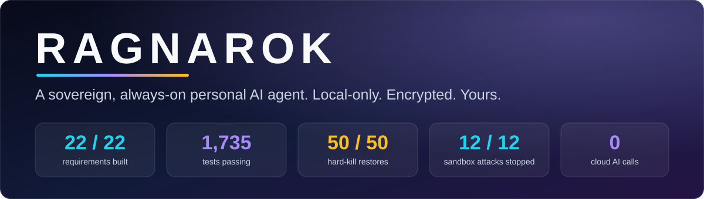
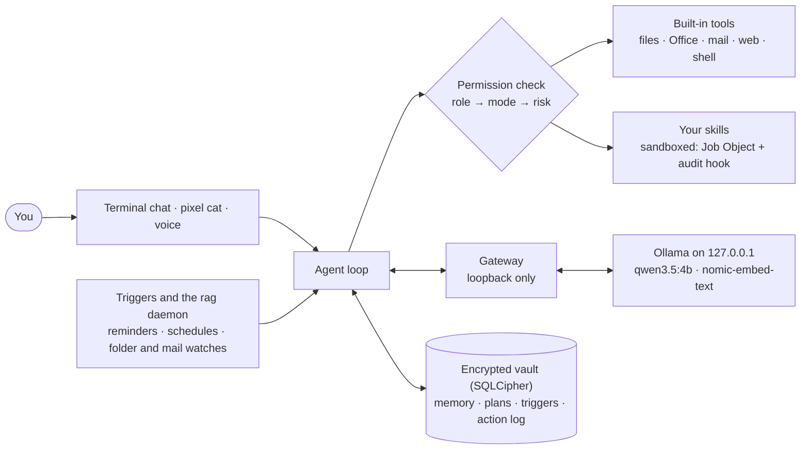

<p align="center">
  
</p>

<p align="center">
  
  
  
  
  
  
</p>

# Ragnarok

A local, always-on personal agent for the IIIT hackathon. Every model call goes to [Ollama](https://ollama.com) on `127.0.0.1`; nothing
leaves the laptop. It remembers you across restarts, uses tools and user-added skills, plans multi-step work, reacts to reminders, folders and
mail by itself, recovers after a crash, and keeps everything it knows in one encrypted file.

Requirements: `Ragnarok A Sovereign, Always-On Personal AI Agent.pdf` (FR1-FR4, NFR1-NFR4).
**Start with [`docs/HACKATHON.md`](docs/HACKATHON.md)**: what the hackathon asks, the approach we took, what we achieved, the demo script and the honest limits.
Then: [`docs/REQUIREMENTS.md`](docs/REQUIREMENTS.md) (the 22-item tracker with evidence), [`ARCHITECTURE.md`](ARCHITECTURE.md) (design, with a built-versus-designed table in section 0.1),
[`docs/MEMORY.md`](docs/MEMORY.md) (memory spec), [`docs/DECISIONS.md`](docs/DECISIONS.md) (why we chose things, D-001 to D-051),
[`docs/WORKLOG.md`](docs/WORKLOG.md) (what happened and what was measured), [`AGENTS.md`](AGENTS.md) (rules for contributors and coding agents).

## How it fits together



Everything the agent does is written to the vault *before* it happens, so memory, plans, triggers and crash recovery all read the same truth.
Every model call goes through one gateway to Ollama on the loopback address; there are no cloud models and no API keys.

## By the numbers

Measured on the target laptop (HP OMEN 16, RTX 4050 6 GB). Each row has a command to re-run it in the [measurements table](#measured-on-the-target-laptop).

| What | Result | Target |
|---|---|---|
| Retrieval + intent | about **125 ms** | under 800 ms |
| Restore after a hard kill | **50 of 50** restored, p95 **89 ms** | under 5 s |
| Background load (triggers, watches, suggestions) | **0.05%** of the machine, 50 MB peak | under 30% |
| Chat model | `qwen3.5:4b`, 100% on the GPU, **48.8 tok/s**, first token about 145 ms | n/a |
| Hostile skill attempts | **12 of 12** stopped by the sandbox | n/a |
| Everyday tasks on the real model | **61 of 64** | n/a |

The benchmark data for memory is synthetic and written by us, so read those numbers as relative quality, not recall in daily use. The honest limits are listed under the table below and in `docs/HACKATHON.md`.

Target machine: HP OMEN 16, i5-13420H, 16 GB RAM, RTX 4050 6 GB, Windows 11, no WSL or Docker.

*Last updated: 2026-10-26 (IST). 1735 tests pass, 3 skipped, `ruff` clean.*

---

## Status at a glance

**All 22 checklist items are built and backed by a test or a measurement**, two with a stated reading or gap (GPU is above 30% during each answer; the VS Code launch was not verified live). Details and evidence: `docs/REQUIREMENTS.md`.

| Pillar / area | State | Where |
|---|---|---|
| Memory (FR1) | Done: episodic log, facts and preferences, consolidation, forgetting, view/correct/export/delete | `ragnarok/memory/`, `persistent_memory.py` |
| Skills (FR2) | Done: registry with tests-before-register, approval and hash pinning; Windows sandbox; many built-in tools | `ragnarok/skills/`, `ragnarok/sandbox/`, `skills/` |
| Planning (FR3) | Done: validated plans, typed checks, retry, re-plan, dependents blocked, `/resume` | `ragnarok/planning/` |
| Triggers (FR4) | Done: reminders, schedules, folder and mailbox watches, `rag daemon`, rule-based suggestions | `ragnarok/triggers/` |
| Encryption (NFR1) | Done: SQLCipher vault, passphrase + recovery code, optional DPAPI | `ragnarok/memory/vault.py`, `ragnarok/vault/` |
| Recovery (NFR3) | Done: restore after a hard kill in under 0.1 s, circuit breaker | `ragnarok/recovery/` |
| Control (NFR4) | Done: roles, modes, approvals, `/log`, memory controls | `ragnarok/policy/`, `ragnarok/runtime/explain.py` |
| Stated limits | Inference: GPU about 78% for the ~6 s of an answer (about 11% averaged), CPU under 11%; the VS Code launch is untested live; no IMAP | see `docs/REQUIREMENTS.md` |

---

## Try it

You need Ollama running with the project's settings, then three commands. Run them from the repository folder
(`C:\Users\parth\dev\Ai-Agent`), not from a OneDrive folder.

```powershell
cd C:\Users\parth\dev\Ai-Agent
powershell -ExecutionPolicy Bypass -File scripts\start_ollama.ps1   # start Ollama (local-only, models pinned)
uv run python -m ragnarok init     # once: choose a passphrase, save the recovery code it shows you
uv run python -m ragnarok chat     # talk to it: "remember that ...", "open steam", "make a 6-slide ppt on ..."
```

Other ways in:

```powershell
uv run python -m ragnarok gui                  # the pixel cat on your taskbar; click it to chat, double-click to speak one request (answered aloud), or turn on the wake phrase
uv run python -m ragnarok gui --command on     # then typing `meow` anywhere starts the cat
uv run python -m ragnarok daemon               # reminders, schedules and watches with no chat open
uv run python -m ragnarok daemon --startup on  # start the daemon at Windows login (needs automatic unlock)
uv run python -m ragnarok log                  # what the agent did, which rule allowed it
uv run python -m ragnarok doctor               # local-only mode, models, GPU and encryption
```

Inside `chat`:

| Command | What it does |
|---|---|
| `/memories`, `/profile`, `/forget N` | see what it remembers, what is always in its prompt, delete memory N |
| `/plan GOAL`, `/resume` | show a step-by-step plan first, then run it; carry on with a plan that stopped |
| `/inbox`, `/reminders`, `/cancel N` | results and reminders that arrived on their own; what is scheduled; stop one |
| `/suggest` | ideas from what it remembers and what is going on |
| `/skill list\|add PATH\|test NAME\|disable\|enable\|remove` | manage user-added skills (tested in the sandbox and approved first) |
| `/mode ask\|edits\|full` | how much it does without asking |
| `/role owner\|editor\|viewer\|automation` | what it may do at all; going to a role with more rights asks you |
| `/log`, `/log plan` | which tools ran, the reason, the permission rule and the result; a plan's steps |
| `/voice wake on\|off` | the wake phrase "hey Ragnarok" (opt-in, remembered, also in the cat's right-click menu): say it, then your request, and the answer is read aloud |
| `/voice on\|off\|talk\|test`, `/listen` | read answers aloud; hands-free conversation; check the microphone; say one message instead of typing it (speech to text with a local Whisper model, text to speech with Windows' voices; the microphone only opens on these commands) |
| `/clear`, `/quit` | clear the screen; leave (it keeps learning and finishes next time) |

Memory controls: `memory list|search|show|history|forget|archive|restore`, `memory pin|unpin N`, `memory correct N --text "the right fact"`,
`memory revert N`, `memory stats`, `memory consolidate`, `memory prune --dry-run`, `memory maintain`, `memory undo-summary N`, and
`memory export FILE --yes-plaintext` (that file is not encrypted). Run them as `uv run python -m ragnarok memory ...`. Also `ingest`.

What it can do, in everyday words (checked on the real model by `bench/daily_tasks.py`, 61 of 64 on the full run):
make, copy, move, rename and delete (Recycle Bin) files and folders; make Word, PowerPoint, Excel and PDF files and code in several languages, and run it;
open apps, websites and code in VS Code; download named installers and pictures; summarise a folder into a deck or PDF; set reminders and schedules;
read, write and queue email; open Gmail with a message written, or write and send it (`send_gmail`, asks first); keep a task board.
Sending mail asks in every mode.

Screen: `look at my screen and tell me what is open` reads it (one screenshot, kept in memory only). `use the mouse and keyboard to ...` lets it act, after you say yes; hold Esc or move the mouse to stop it, and it never types into a terminal.
Acting is experimental (13 of 15 on our test window, D-046; untested on real browsers or Office). `RAGNAROK_NO_SCREEN=1` turns both off.
`RAGNAROK_NO_DOWNLOADS=1` turns the downloads off.

Voice settings: speech to text is tuned for Indian English (`RAGNAROK_ACCENT=us` turns that off); `RAGNAROK_MIC` picks the microphone; `RAGNAROK_VOICE` picks the voice (automatic: an English (India) voice if installed); `RAGNAROK_NO_VOICE=1` turns voice off.

Mail: a folder of `.eml` files at `%LOCALAPPDATA%\Ragnarok\mail\inbox` (or `RAGNAROK_MAIL_DIR`); `send_mail` writes to `outbox`. `fixtures\mailbox` has two sample messages, one hostile.

The models do not run "in" the terminal: they run in the Ollama background process on your GPU.

---

## Status: what was built, and when

Times are commit times (IST). Details and numbers for each line are in the work log.

### Done

| When (IST) | What | Evidence |
|---|---|---|
| 2026-10-25 14:54 - 16:30 | Team design doc, architecture v2 around the five pillars, decisions D-001 to D-019, project context files | `4108834` ... `e53721f` |
| 2026-10-25 16:55 - 17:55 | **M0-M3** Python 3.12 with uv; SQLCipher vault with FTS5 and migrations; key management (Argon2id, recovery code, DPAPI); memory core (FTS5 + vectors + RRF + rerank); lifecycle (supersede, archive, hard delete); extraction with ADD / UPDATE / SUPERSEDE / NOOP and code-enforced safety rules | `2a6d6f4` ... `0a75ecd` |
| 2026-10-25 18:00 - 18:53 | **M4** profile block, `memory_search` / `memory_save`, permission check, chat loop with log-before-act, terminal CLI, `open_app`, read-only file skill, `persistent_memory.py` | `ba97b86` ... `3306cfb` |
| 2026-10-25 19:39 | **M5** weekly summaries, forgetting by usefulness, delete cascade, undo, daily maintenance | `1eda367`, `27fedd9` |
| 2026-10-25 20:10 - 22:15 | `open_website`; screen skill (experimental); downloads and Word documents | `8412f03`, `048167a`, `b92bc9c` |
| 2026-10-26 00:40 | Day-to-day work: permission modes, file operations, Office files, shell; everyday battery on the real model | `2ef6e0a`, `7418b17` |
| 2026-10-26 01:49 - 02:54 | Claude Code-style terminal; folder summaries, animations; **triggers** (reminders, schedules, folder watches, Inbox); password and address guards (D-039..D-042) | `a965391`, `38fed10` |
| 2026-10-26 03:20 - 03:26 | **Planning (FR3)**: validated plans, typed checks, failure ladder, `/plan`, `/resume`; shared circuit breaker (D-043) | `6f55097`, `be92bfe` |
| 2026-10-26 03:59 - 05:40 | **The pixel cat** (tkinter): taskbar cat that opens a chat, `meow`, automatic unlock, right-click "What is on my screen?" (D-044, D-045) | `4022a6a` ... `a75e082` |
| 2026-10-26 06:14 | Screen acting fixed: 3/10 to 13/15 on the live test window (D-046) | `1819246` |
| 2026-10-26 08:24 | **Skills registry and sandbox** (D-047); **crash restore** with a 50-kill bench (D-048); **`rag daemon`** and rule-based suggestions (D-049); mail and task board (D-050); **roles, `/log`** (D-051) | `f2cd46d` |
| 2026-10-26 (later) | **Gmail in the browser** (`compose_email`, `send_gmail`, verified live); sending mail asks in every mode; **`open_in_editor`** (VS Code); inference measured (`bench/inference_bench.py`); requirements tracker and judge guide | see `docs/WORKLOG.md` |

### Remaining

| Item | Status |
|---|---|
| Try `open in vs code` on your own screen (it would not start from the shell used for testing) | **next, needs you** |
| Use it for a few days with your real vault; consolidation has not run on a real vault yet (needs finished weeks with 4+ notes each) | **next, needs you** |
| Real IMAP/Gmail API; an external project-management product | not started |
| Leave the daemon running for hours; start it at a real Windows login | not tried |
| Model-written suggestion text; more suggestion patterns | not started |
| Summaries grouped by entity; an export encrypted with a passphrase; a held-out evaluation set for memory | not started |
| Paraphrased questions are the weak spot of retrieval (recall@5 about 0.77) | idea: query expansion |
| Screen acting on real apps (browser, Explorer, Office) | experimental |
| Web UI, tray icon, Proof panel (the cat GUI and CLI replaced them) | dropped for now |

---

## Measured on the target laptop

| What | Result | Re-run |
|---|---|---|
| Chat model `qwen3.5:4b` | `100% GPU` at 16k context, 48.8 tok/s, first token about 145 ms with a cached prefix | `bench.llm_bench` |
| Embedding `nomic-embed-text` | 768-d, `100% GPU`, query embed p50 82 ms / p95 117 ms | `bench.embed_bench` |
| Retrieval quality (500 memories, 124 labelled queries) | recall@5 0.895, MRR 0.835; superseded and deleted memories never returned | `bench.retrieval_bench` |
| **Retrieval + intent (NFR2.1, target under 800 ms)** | about 125 ms: embedding p95 117 ms + search p95 6.7 ms + intent 0.013 ms | `bench/resource_bench.py` |
| **Background load (NFR2.2, target under 30%)** | engine with 3 folders x 300 files, 8 triggers, suggestions: **0.05% of the machine**, 50 MB peak | `bench/resource_bench.py` |
| **Inference load (NFR2.2)** | Ollama **0.0% CPU idle, 8.3% (peak 10.7%) generating**; GPU **3.8% idle, 77.7% (peak 86%) during a ~6 s answer**; about 11% GPU averaged at one request a minute; 5.3 of 6.1 GB VRAM held | `bench/inference_bench.py` |
| **Restore after a hard kill (NFR3.2, target under 5 s)** | 50 of 50 runs restored; restart p95 89 ms, max 223 ms | `bench/recovery_bench.py` |
| Restart with 10k memories | index rebuilt in 0.44 s, or loaded from the saved blob in 0.20 s | `bench.retrieval_bench` |
| Extraction from events (15 hand-written cases) | 15/15; p50 1.7 s. ADD/UPDATE/SUPERSEDE decisions 12/12 | `bench.ingest_eval` |
| Everyday tasks on the real model | 61 of 64 on the full run; mail, task and Gmail prompts pick the right tool | `bench.daily_tasks` |
| Plans on the real model | 3 multi-step goals: 3/3 on the latest run (2/3 on another); plans in 4-5 s | `bench.plan_tasks` |
| Screen acting (experimental) | 13 of 15 on the live test window | `bench.screen_eval` |
| Sandbox | 12 of 12 hostile attempts stopped | `tests/test_sandbox.py` |
| Key derivation | Argon2id about 0.4 s (256 MiB, only while unlocking) | |

Caveats: the memory benchmark data is synthetic and written by us, and the extraction prompts were tuned on the same small cases, so those numbers show relative quality
and that the safety rules work, not recall in daily use. The Turbovec index missed our 0.95 recall bar (0.92), so the default is exact search until the corpus grows (D-026).
The retrieval figure above uses the real embedding latency from the 2026-10-25 run plus a search measured with a stand-in embedder.

---

## Develop

```powershell
winget install astral-sh.uv            # Python 3.12 is installed by uv
uv sync
ollama pull qwen3.5:4b
ollama pull nomic-embed-text

uv run pytest -q
uv run ruff check .
uv run python -m bench.embed_bench
uv run python -m bench.llm_bench
uv run python -m bench.retrieval_bench    # writes bench/results/retrieval_<date>.json
uv run python -m bench.ingest_eval        # real-model extraction and decision quality
uv run python -m bench.consolidate_eval   # real-model weekly summaries and their validation
uv run python -m bench.chat_latency       # how long each kind of chat turn takes
uv run python -m bench.m4_demo            # end-to-end: tell it facts, restart, come back
uv run python -m bench.daily_tasks        # everyday requests on the real model (a name filter works)
uv run python -m bench.plan_tasks         # multi-step goals on the real model
uv run python bench/recovery_bench.py     # NFR3.2: kill and resume, 50 times
uv run python bench/resource_bench.py     # NFR2: background cost and hot-path latency
uv run python bench/inference_bench.py    # NFR2.2: CPU and GPU while the model answers
```

Use `127.0.0.1`, never `localhost`, for Ollama: `localhost` adds about 2 s to the first connection on this machine.
Runtime data (vault, keys, mail folder, logs) belongs in `%LOCALAPPDATA%\Ragnarok\` (or `RAGNAROK_HOME`), never in the repository or OneDrive;
the CLI refuses a data folder inside OneDrive.

On Windows, write files with LF line endings (the repository uses LF), and run `ruff format` only on the files you changed.

## Layout

```text
ragnarok/
  cli.py, chat.py, ui.py   terminal front end: init, chat, memory, ingest, daemon, log, gui, doctor
  persistent_memory.py     the whole memory lifecycle in one readable file (start here)
  memory/        vault.py (SQLCipher, migrations 0001-0008)  store.py  ingest.py  profile.py  index.py
                 consolidate.py  forget.py  service.py
  vault/         keys.py (passphrase, recovery code, DPAPI)
  runtime/       gateway.py (the only path to a model)  loop.py (agent loop)  context.py  tools.py
                 explain.py (/log)  prompts/
  policy/        permissions.py (every tool call is checked here)  modes.py  roles.py
  planning/      intent, planner, runner, store (FR3)
  triggers/      engine, schedule, store, tools, proactive, daemon, toast (FR4)
  recovery/      breaker.py (NFR3.1)  restore.py (NFR3.2)
  sandbox/       runner.py (Job Object, scrubbed environment)  guard.py (audit hook)
  skills/        registry.py (user-added skills) + built-in tools: files, fileops, office, documents, web,
                 webpage, mail, tasks, shell, apps, downloads, images, digest, screen/
  gui/           the pixel cat (tkinter): sprites, brain, chat window, unlock dialog, startup
skills/          user-facing skills (SKILL.md + skill.json), e.g. text-stats
fixtures/        evil-skill (hostile test skill), mailbox (sample .eml files)
bench/           benchmarks; results in bench/results/
tests/           1735 tests, one file per area
docs/            HACKATHON.md  REQUIREMENTS.md  MEMORY.md  DECISIONS.md  WORKLOG.md  history/
```

## Privacy rules

- All inference is local: one gateway, loopback only, no cloud models, no API keys.
- User content is stored only in the encrypted vault. The log files carry ids, timings and error types, never content.
- Secrets that appear in text (passwords, tokens, API keys) are redacted before anything is stored.
- Deleting a memory removes its row, search entries, vector and links, and leaves only an id and time in the audit log.
- Text from memory, files, web pages or email reaches the model only inside data tags, and the system prompt says never to follow instructions found there.
- Ragnarok never stores an email password. Gmail is driven through your own signed-in browser, and sending always asks first.
