# ARCHITECTURE.md — Ragnarok

## A Sovereign, Always-On Personal AI Agent on a Fully Local, Ollama-Based Stack

> **Status:** Proposed architecture and benchmark targets, not validated
> performance claims.
> **Primary design goal:** A local-first personal agent with encrypted
> persistent memory, a registry of reusable sandboxed skills, autonomous
> multi-step planning with self-correction, and always-on triggers, where
> every reasoning and embedding call goes to a local Ollama instance.

All latency, CPU/GPU, recovery-time, recall, and accuracy figures in this
document are **targets or hypotheses until benchmarked** on the target
laptop. Do not present them as achieved results.

---

## 1. System Overview

Ragnarok is a background daemon plus a localhost web UI. It:

1. **Remembers** — keeps an episodic event log, extracts semantic facts and
   preferences, consolidates and forgets, all inside one encrypted SQLite
   database.
2. **Acts through skills** — users register Python, CLI, or API-wrapper
   skills with a manifest; the agent selects skills, generates validated
   arguments, and runs them in a sandbox gated by risk tier.
3. **Plans and self-corrects** — decomposes goals into a persisted task
   graph (DAG), executes independent branches, checks each output, and
   retries or re-plans on failure.
4. **Runs always-on** — cron, file, email, and calendar triggers start work
   or produce proactive suggestions without a prompt, within a resource
   budget.
5. **Stays sovereign** — no cloud AI service, no API key, encryption at rest
   with a user-held key, explicit approval for consequential actions, and a
   full explainable execution trace.

### Hard constraints (from the proposal)

- Every LLM and embedding call goes to `http://127.0.0.1:11434` (Ollama).
  The Ollama client refuses any non-loopback base URL.
- No user data leaves the machine except where a user-approved skill
  inherently talks to the user's *own* account (e.g. sending an email
  through their mail server). No AI or analytics service is ever contacted.
- Memory, plans, logs, and vectors are encrypted at rest.

---

## 2. Design Principles

1. **Local-first, local-only inference.** Ollama for chat, tool calling,
   structured output, and embeddings.
2. **One encrypted source of truth.** SQLCipher holds events, facts,
   vectors, plans, working memory, approvals, and audit logs. Every
   in-memory structure is derived and rebuildable from it.
3. **Hybrid retrieval with evidence.** Lexical FTS5 search plus vector
   search, fused with Reciprocal Rank Fusion; every result carries its
   source ID so answers cite evidence.
4. **Proposals are not permissions.** The LLM proposes plans and tool
   calls; a trusted, deterministic executor validates them against schemas
   and policy before anything runs.
5. **Checkpoint before side effects.** Every task state transition is
   committed before and after execution, so crashes are recoverable and
   non-idempotent actions are never silently repeated.
6. **Automatic forgetting is reversible; user deletion is permanent.**
   Background pruning archives; a user-initiated delete hard-deletes and
   cascades.
7. **Measured performance.** Report p50/p95, resource use, and recovery
   time from repeatable benchmarks.

---

## 3. Architecture

```mermaid
flowchart TB
    subgraph Inputs
        UI[Local Web UI<br/>chat · approvals · memory manager]
        TR[Trigger Engine<br/>cron · file · email · calendar]
    end

    subgraph Core["Cognitive Core"]
        IR[Intent Router<br/>embedding kNN + small-LLM fallback]
        PL[Planner<br/>goal → task DAG]
        EX[Executor<br/>DAG scheduler]
        RF[Reflection<br/>checks · retry · re-plan]
        PR[Proactivity Engine]
    end

    subgraph Skills["Skill Layer"]
        REG[Skill Registry<br/>manifests + schemas]
        POL[Policy / RBAC<br/>JIT approvals]
        SB[Sandbox Runner<br/>container or restricted subprocess]
    end

    subgraph Memory["Sovereign Memory (SQLCipher)"]
        EP[Episodic events]
        SEM[Semantic facts]
        WM[Working memory]
        VEC[Vectors + FTS5]
        PLN[Plans / tasks]
        AUD[Audit + traces]
    end

    OL[(Ollama @ 127.0.0.1<br/>chat · tools · embed)]
    GOV[Resource Governor]

    UI --> IR
    TR --> PR
    PR --> PL
    IR --> PL
    IR -->|simple request| EX
    PL --> EX
    EX --> POL --> SB
    REG --> PL
    REG --> SB
    SB --> RF --> EX
    RF -->|repair subgraph| PL
    Core <--> Memory
    Core --> OL
    Memory --> OL
    GOV -.throttles.-> TR
    GOV -.throttles.-> Core
    EX --> UI
```



### Layers

| # | Layer | Core technologies | Responsibility |
|---|-------|-------------------|----------------|
| 1 | Interface & Triggers | FastAPI + WebSocket, HTML/JS UI, APScheduler, `watchdog`, IMAP, ICS/CalDAV | Accept user goals, show plans/approvals/memories, fire time- and event-based triggers |
| 2 | Cognitive Core | Ollama (`/api/chat` with tools and JSON-schema `format`, `/api/embed`) | Intent routing, planning, reflection, proactivity, answer generation |
| 3 | Skill Layer | YAML manifests, JSON Schema, Docker/WSL2 or restricted subprocess, Windows Job Objects | Register, validate, authorize, and sandbox skills |
| 4 | Sovereign Memory | SQLCipher, FTS5, numpy vector matrix, `nomic-embed-text` | Encrypted storage of everything; hybrid retrieval; consolidation and forgetting |
| 5 | Governance | Policy engine, approvals, audit log, resource governor | RBAC, JIT approval, explainability traces, CPU/GPU budget |

### Initial model configuration (validate on target laptop)

| Role | Candidate | Notes |
|------|-----------|-------|
| Main reasoning / planning | `qwen2.5:7b-instruct` or `llama3.1:8b` (Q4) | Must support Ollama tool calling and structured output; confirm GPU fit |
| Fast intent fallback / reflection judge | `qwen2.5:1.5b` or `llama3.2:3b` | Small enough to stay within the latency budget |
| Embeddings | `nomic-embed-text` | Confirm dimensionality (expected 768) and the `search_query:` / `search_document:` prefixes before indexing |

Set `OLLAMA_NUM_PARALLEL=1`, a short `keep_alive` for the large model, and
`num_thread` caps so the agent respects the resource budget (§10).

---

## 4. Sovereign Memory

### 4.1 Storage and encryption (NFR1.2)

- **Database:** a single SQLCipher file `data/ragnarok.db`, WAL mode,
  `PRAGMA secure_delete = ON`. Python binding: `sqlcipher3` (verify that
  the build includes FTS5 at Milestone 0; fallback is building SQLCipher
  with `SQLITE_ENABLE_FTS5`).
- **Keys:**
  - A random 256-bit **data key** encrypts the database.
  - The data key is wrapped by a **key-encryption key** derived from the
    user's passphrase with Argon2id and stored as `data/key.wrapped`.
  - For unattended always-on restarts, the data key may *optionally* also
    be sealed with Windows DPAPI (user scope) via the OS credential store.
    This is opt-in: it trades "passphrase at every boot" for "tied to the
    user's Windows login."
  - The user can export a recovery key; losing both passphrase and recovery
    key means the memory is unrecoverable, by design.
- **What is encrypted:** events, facts, vectors (stored as BLOBs), plans,
  working memory, approvals, audit traces — everything is in the one file.
  Vectors are decrypted only in process RAM.
- **Threat model:** protects data at rest (stolen disk, copied file, cloud
  sync of the folder). It does not protect against malware running as the
  logged-in user while the agent is unlocked.

### 4.2 Schema (core tables)

```text
events          id, ts_utc, event_type, source, actor, raw_text, content_hash,
                importance, access_count, last_accessed, pinned,
                state('active'|'archived'), retention_until
facts           id, kind('preference'|'fact'|'project_state'), subject,
                statement, confidence, valid_from, superseded_by, pinned,
                state, created_ts
fact_sources    fact_id, event_id                       -- provenance
summaries       id, period_start, period_end, text, created_ts
summary_sources summary_id, event_id
embeddings      owner_type('event'|'fact'|'summary'), owner_id, model,
                dim, vector BLOB                         -- float32
events_fts      FTS5(raw_text, content='events', content_rowid='id')
facts_fts       FTS5(statement, content='facts', content_rowid='id')
working_memory  session_id, key, value_json, updated_ts
plans           id, goal, origin('user'|'trigger'), actor, status,
                created_ts, updated_ts, replan_count
tasks           id, plan_id, skill, args_json, depends_on_json,
                success_criteria_json, status, attempt, max_attempts,
                output_json, error, idempotency_key, updated_ts
approvals       id, task_id, scope('once'|'plan'|'rule'), rule_json,
                decision, decided_ts, expires_ts
traces          id, ts, plan_id, task_id, kind, payload_json   -- explainability
audit_log       id, ts, actor, action, target, result, tombstone
schema_version  version
```

Use parameterized SQL, explicit migrations, and transactions for every
multi-table write.

### 4.3 Episodic memory (FR1.1)

Every user turn, assistant answer, plan, task result, trigger firing, and
approval decision is written as an event with a UTC timestamp and actor.
Deduplicate by `content_hash` plus source and time window. Embedding happens
asynchronously in the background job queue.

### 4.4 Semantic memory (FR1.2)

After each interaction (low priority, in the background):

1. The small model extracts candidate **preferences, facts, and project
   states** as JSON (`kind`, `subject`, `statement`, `confidence`) with
   the source event IDs.
2. Each candidate is embedded and compared to existing facts on the same
   subject:
   - near-duplicate → reinforce (raise confidence, add source);
   - contradicting → new fact supersedes the old (`superseded_by`), keeping
     history;
   - new → insert.
3. Facts below a confidence threshold are not shown to the planner until
   reinforced.

Facts are the structured knowledge layer: the planner and proactivity
engine read them directly (e.g. "prefers meetings after 2 pm").

### 4.5 Working memory and consolidation (FR1.3)

- **Working memory** = the active session: current goal, active plan IDs,
  last N turns, pinned facts. Persisted in `working_memory` on every update
  so it survives crashes (NFR3.2).
- **Consolidation** (nightly or when idle, governed by §10):
  1. Select a bounded window of related events.
  2. Ask the local LLM for a summary that cites source event IDs.
  3. Validate that every cited ID exists and the summary does not
     introduce entities absent from its sources.
  4. Store the summary + `summary_sources`, embed it.
  5. Run fact extraction over the window.
  6. Mark source events as consolidated. Idempotent and resumable.

### 4.6 Forgetting (FR1.3)

Each event and fact has a **salience score**:

```text
salience = w_r · exp(-age / τ) + w_a · log(1 + access_count)
         + w_i · importance + w_c · consolidated_into_summary_or_fact
```

- **Pinned** items are never forgotten.
- **Archive (reversible):** items below the salience threshold are removed
  from the vector matrix and default search, but stay in the DB and can be
  restored from the Memory Manager.
- **Purge (permanent):** only archived items past a *user-configured*
  `retention_until` that are already covered by a summary or fact.
- Superseded facts are archived, not purged, unless the user deletes them.

### 4.7 Hybrid retrieval

`recall(query, k, filters)`:

1. Embed the query (`search_query:` prefix).
2. In parallel:
   - **Lexical:** FTS5 BM25 over `events_fts` and `facts_fts` — catches
     exact identifiers (`0x80070005`, `auth_middleware.py`, port `8089`).
   - **Semantic:** cosine similarity against the in-memory vector matrix.
3. **Reciprocal Rank Fusion:**
   `RRF(d) = Σ_j 1 / (k + rank_j(d))`, starting at `k = 60`, tuned on the
   evaluation set. Missing from a list contributes zero.
4. **Rerank:** query-aware recency boost for "today / last time / ongoing"
   questions only; stable facts are not buried by age. Apply sensitivity and
   state filters.
5. Resolve to rows, bump `access_count`, and return `MemoryResult`
   (source ID, type, timestamp, excerpt, lexical rank, semantic rank, fused
   score, retrieval reason).

**Vector index choice:** at hackathon scale, exact brute-force search over
a float32 numpy matrix loaded from encrypted BLOBs is simple, exact, and
fast (10k × 768 × 4 B ≈ 31 MB). Re-evaluate beyond ~50k vectors: float16 or
int8 quantization, `sqlite-vec`, or Turbovec (benchmark against the exact
baseline; do not claim implementation details of TurboQuant/QJL without
source inspection). Any external index file must also be encrypted or
rebuilt from the DB at startup.

### 4.8 User control over memory (NFR4.2)

The Memory Manager page supports:

- **View / search** events, facts, summaries with provenance links.
- **Edit** a fact or summary (re-embedded; edit recorded in audit log).
- **Pin / unpin**, **archive / restore**.
- **Export** selected or all memories as JSONL (plaintext — the UI warns
  before writing it to disk).
- **Permanent delete** with a cascade preview:
  - delete the row, its FTS entry, and its embedding;
  - facts whose *only* source is the deleted event are deleted; facts with
    other sources lose that provenance link;
  - summaries citing it are regenerated from remaining sources or deleted;
  - remove it from the in-memory vector matrix and working memory;
  - write a content-free tombstone (`id`, `deleted_ts`) to the audit log;
  - checkpoint WAL; `secure_delete` overwrites freed pages.

---

## 5. Skill Layer

### 5.1 Skill registration (FR2.1)

A skill is a folder under `skills/` with a manifest:

```yaml
# skills/calendar_create_event/skill.yaml
name: calendar.create_event
version: 1.0.0
description: Create an event in the user's local calendar.
entrypoint:
  type: python            # python | cli | http
  module: main:run        # cli: command template; http: local/approved URL
params:                   # JSON Schema
  type: object
  required: [title, start, end]
  properties:
    title: {type: string, maxLength: 200}
    start: {type: string, format: date-time}
    end:   {type: string, format: date-time}
    attendees: {type: array, items: {type: string, format: email}}
returns:
  type: object
  properties: {event_id: {type: string}}
risk: R2                  # see 5.4
idempotent: false
permissions:
  filesystem: ["~/Calendars/ragnarok.ics:rw"]
  network: []             # empty = no network
timeout_s: 20
sandbox: subprocess       # container | subprocess
success_check:            # deterministic post-condition (optional)
  output_has: [event_id]
```

- `ragnarok skill add <path>` validates the manifest, shows the declared
  permissions and risk tier, and requires the owner to approve
  registration.
- Skills are versioned; manifest changes that widen permissions require
  re-approval.
- Each skill's description is embedded for the intent router.
- **Built-in starter skills** (enough for the demo): `email.fetch_unread`,
  `email.classify`, `email.draft_reply`, `email.send`, `calendar.find_slots`,
  `calendar.create_event`, `files.search`, `files.read`, `files.write`,
  `notes.write`, `code.generate_patch`, `code.run_tests`, `memory.recall`.

### 5.2 Dynamic tool selection (FR2.2)

- For a single-step request, the router picks candidate skills (§6.1) and
  the LLM is offered **only the top-k skill schemas** as Ollama tools,
  keeping the prompt small and the choice focused.
- Generated arguments are validated against the JSON Schema; on failure the
  validation error is returned to the model for one repair attempt.
- Multi-step goals go to the planner (§6.2).

### 5.3 Sandboxed execution (FR2.3)

Two sandbox profiles, chosen by manifest and policy:

| Profile | Mechanism | Use for |
|---------|-----------|---------|
| `container` | Docker Desktop / WSL2: `--network none` unless declared, read-only root, only declared paths mounted, CPU/memory limits, non-root user | User-authored or untrusted Python/CLI skills, `code.run_tests` |
| `subprocess` | Separate process, scrubbed environment, restricted working directory, Windows Job Object CPU/memory/time limits, argument arrays (never shell strings), declared-path checks in the runner | Trusted built-in skills that need host app access |

Be explicit in docs and demo: the `subprocess` profile limits damage from
errors but **is not a security boundary**. Untrusted code must use
`container`. If no container runtime is present, untrusted skills are
refused, not downgraded.

Skills never receive the DB key or direct DB access; they get inputs and
return JSON. Skill output is treated as untrusted (§9).

### 5.4 Risk tiers and RBAC (NFR4.3)

| Tier | Meaning | Examples | Default policy |
|------|---------|----------|----------------|
| R0 | Read-only, local | `memory.recall`, `files.search`, `calendar.find_slots` | Auto-allowed |
| R1 | Local, reversible writes | `notes.write`, `email.draft_reply` | Auto for owner; approval for automation |
| R2 | External or hard to reverse | `email.send`, `calendar.create_event` | JIT approval always |
| R3 | Destructive | `files.delete`, arbitrary shell | JIT approval, scope `once` only |

**Actors (roles):** `owner` (interactive user), `automation` (trigger-
initiated plans), `skill` (a skill invoking another skill). Policy lives in
`config/policy.yaml` as `actor × skill/tier → allow | approve | deny`, with
optional argument constraints (e.g. `email.send` allowed only to addresses
already in contacts).

**Just-in-time approval:** when a task needs approval, it moves to
`awaiting_approval` and the UI shows the skill, arguments, a preview/diff,
the rationale, and the evidence it relied on. The owner chooses *once*,
*for this plan*, or *rule* (argument pattern + expiry; not available for
R3). Every decision is logged. Independent tasks keep running while one
waits.

---

## 6. Cognitive Core

### 6.1 Intent router (NFR2.1)

Goal: retrieval + intent classification in **< 800 ms** (target).

1. Embed the query once; reuse the vector for both memory retrieval and
   routing.
2. kNN over embedded skill descriptions + labeled intent exemplars
   (`chat`, `recall`, `single_skill`, `multi_step_goal`, `manage_memory`).
3. If the top score is confident, route directly; otherwise ask the small
   model with a constrained JSON-schema output.
4. Memory retrieval runs in parallel with step 2–3.

Budget hypothesis (warm models, measure on target): embed ≈ 50–150 ms,
FTS5 + vector + fusion ≈ < 50 ms, kNN routing ≈ < 5 ms, small-LLM fallback
≈ 200–500 ms (only on low confidence). The full answer and plan generation
are *not* inside the 800 ms budget; the UI streams them.

### 6.2 Planner (FR3.1)

The planner turns a goal into a DAG using Ollama structured output with a
JSON Schema:

```json
{
  "goal": "Triage today's email, schedule meeting requests, and fix the failing test mentioned by Priya",
  "tasks": [
    {"id": "t1", "skill": "email.fetch_unread", "args": {"since": "today"}, "depends_on": []},
    {"id": "t2", "skill": "email.classify", "args": {"emails": "$t1.emails"}, "depends_on": ["t1"]},
    {"id": "t3", "skill": "calendar.find_slots", "args": {"requests": "$t2.meeting_requests"}, "depends_on": ["t2"],
     "success_criteria": "one slot per request, inside user's preferred hours"},
    {"id": "t4", "skill": "calendar.create_event", "args": {"slot": "$t3.slots[0]"}, "depends_on": ["t3"]},
    {"id": "t5", "skill": "code.generate_patch", "args": {"issue": "$t2.code_issues[0]"}, "depends_on": ["t2"]},
    {"id": "t6", "skill": "code.run_tests", "args": {"patch": "$t5.patch"}, "depends_on": ["t5"],
     "success_criteria": "all tests pass"},
    {"id": "t7", "skill": "notes.write", "args": {"text": "$t2.summary"}, "depends_on": ["t2"]}
  ]
}
```

Planner inputs: goal, relevant facts/preferences, recent episodic context,
working memory, and the registry's skill list (names + descriptions).

**Validation before anything runs:** acyclic graph; every skill exists;
`$tN.field` references point to upstream tasks; literal arguments match
schemas; policy check per task (tasks that will need approval are marked so
the user sees them upfront). Invalid plans go back to the planner with the
errors (max 2 attempts), then fall back to asking the user.

The validated plan and all tasks are written to `plans`/`tasks` **before**
execution starts.

### 6.3 Executor (FR3.2, NFR3.1)

- Topological scheduling with a small concurrency limit (default 2).
- Task states: `pending → ready → [awaiting_approval] → running →
  succeeded | failed | blocked | skipped | needs_review`.
- Every transition is committed. Before running a non-idempotent skill, the
  executor writes `running` with an `idempotency_key`; after it returns, it
  writes the result.
- **Graceful degradation:** when a task fails permanently, only its
  descendants become `blocked`; independent branches continue (in the
  example, `t7` and the `t5→t6` branch still run if calendar access fails).
  The user is notified with what failed, why, and what still completed.
- Cross-application integration happens only through skills, so every
  external app touch is registered, permissioned, and logged.

### 6.4 Reflection and self-correction (FR3.3)

After each task:

1. **Deterministic checks first:** schema-valid output, exit code, manifest
   `success_check`, declared post-conditions (e.g. tests pass).
2. **LLM judge** (small model) only if the task has natural-language
   `success_criteria`, returning `{pass, reason}` as structured output.
3. On failure:
   - transient errors (timeout, connection) → retry with backoff up to
     `max_attempts` (default 3);
   - argument/logic errors → ask the planner to **repair the subgraph**
     (the failed task and its descendants only), given the error and
     output; max `replan_count` 2 per plan;
   - otherwise → mark `failed`, degrade gracefully, notify.
4. Each verdict and repair is written to `traces`.

Reflection outcomes also become episodic events, so the agent can recall
"last time `calendar.find_slots` failed because the ICS file was locked."

### 6.5 Answer generation

Answers are generated from the user's message, retrieved evidence (with IDs),
working memory, and task outputs. The prompt marks retrieved and tool
content as untrusted data (§9). Answers cite memory IDs that the UI links
to the Memory Manager.

---

## 7. Always-On Triggers and Proactivity (FR4)

### 7.1 Trigger engine (FR4.1)

Triggers are defined in `config/triggers.yaml` or the UI:

```yaml
- id: morning_brief
  type: cron
  schedule: "0 8 * * 1-5"
  action: {goal: "Prepare my morning brief from today's calendar, unread email, and open tasks"}
- id: inbox_watch
  type: email            # IMAP IDLE, or polling with configurable interval
  account: personal
  filter: {unread: true}
  action: {skill: email.classify}
- id: downloads_invoices
  type: file             # watchdog
  path: "~/Downloads"
  pattern: "*invoice*.pdf"
  action: {goal: "File this invoice and note the due date", args: {path: "$event.path"}}
```

- Trigger-initiated plans run as actor `automation`, so by default they can
  do R0 work automatically, need approval for R1+, and surface the result as
  a suggestion or notification rather than acting silently.
- Event-driven hooks (IMAP IDLE, `watchdog`) are preferred over polling;
  where polling is needed, the interval is configurable and its CPU cost is
  measured.
- Trigger state (last fired, cursor such as last seen email UID) is
  persisted so restarts neither miss nor duplicate events.

### 7.2 Proactivity engine (FR4.2)

Periodically (and after triggers), the engine combines facts, upcoming
calendar items, stalled plans, and recent events to propose actions, e.g.
"You have a 3 pm with Priya and the failing test she mentioned is still
open — want me to draft a fix?"

- Suggestions go to a notification inbox with a reason and evidence.
- Rate-limited (configurable max per hour, quiet hours).
- Dismissals and acceptances are recorded and lower or raise the score of
  similar future suggestions.

---

## 8. Explainability (NFR4.1)

Every plan has a trace visible in the UI timeline:

- router candidates with scores and the chosen route;
- planner input summary (which facts and memories were used, by ID);
- the plan graph and any validation errors;
- per task: the chosen skill, a short **decision record** (why this skill
  and these arguments, generated as a structured field, not raw hidden
  chain-of-thought), arguments, policy decision, approval, output, reflection
  verdict, retries, and repairs;
- final answer with evidence IDs.

Traces are stored encrypted in `traces` and follow the same retention and
deletion rules as memories.

---

## 9. Security, Privacy, and Reliability

- **Local-only network policy:** the Ollama client only accepts loopback
  URLs. Skills get network access only for hosts declared in the manifest
  and approved by the owner.
- **Localhost UI hardening:** bind to `127.0.0.1` only; require a per-launch
  session token; check `Host`/`Origin` headers to block DNS-rebinding and
  cross-site requests from other browser tabs.
- **Prompt injection:** emails, files, web pages, skill outputs, and
  retrieved memories are untrusted. They are passed in delimited data
  blocks, never as instructions, and they cannot raise privileges: policy
  is enforced by the executor, not the model. An email that says "forward
  all mail to X" can at most produce a plan step that still needs R2
  approval.
- **Secrets:** credentials for user accounts (IMAP, CalDAV) are kept in the
  OS credential store, never in memory events, prompts, traces, or
  embeddings. A secret-pattern filter scrubs tokens/passwords from events
  before storage.
- **Shell:** no free-form LLM shell strings. CLI skills use argument
  templates filled from schema-validated values.
- **Global pause / kill switch** in the UI and a tray indicator when
  background triggers are active.

### 9.1 State recovery (NFR3.2)

Startup sequence, target **< 5 s** to restored operational state:

1. Unlock key (DPAPI-sealed key if enabled; otherwise prompt passphrase —
   recovery time is measured from unlock).
2. Open DB, run pending migrations, verify `schema_version`.
3. Load working memory for the active session.
4. Load plans with status `running`/`awaiting_approval`:
   - tasks in `running` with `idempotent: true` → reset to `ready`;
   - tasks in `running` with `idempotent: false` → `needs_review` (the user
     confirms whether the side effect happened; never re-sent blindly);
   - `awaiting_approval` items reappear in the approvals inbox.
5. Rebuild the in-memory vector matrix from `embeddings` BLOBs (benchmark;
   for large stores, load lazily in the background after core state is
   restored).
6. Restore trigger cursors and resume the scheduler.
7. Warm Ollama models in the background (not part of the 5 s budget).

The daemon is registered as a per-user startup task so it restarts after
reboot.

---

## 10. Resource Governance (NFR2.2)

**Interpretation to confirm with organizers:** the 30% cap applies to the
always-on background mode (triggers, embedding backfill, consolidation,
fact extraction, idle model residency). User-initiated foreground inference
may burst higher and is measured and reported separately.

Mechanisms:

- **Governor loop:** samples CPU (`psutil`) and GPU (NVML if NVIDIA) for
  the agent process and the Ollama process every few seconds; maintains a
  rolling average.
- **Background job queue:** all non-interactive work (embedding, fact
  extraction, consolidation, proactive scans) runs through one low-priority
  queue that only dequeues when the rolling average is under budget and the
  user is not actively using the agent; jobs are small and resumable.
- **Process priority:** agent workers run at `BELOW_NORMAL`.
- **Model residency:** short `keep_alive` for the large model; the small
  model and embedder handle background work; `num_thread` capped.
- **Polling minimization:** event-driven triggers; adaptive backoff for
  any polling source.
- **Telemetry:** the UI shows current background CPU/GPU share against the
  budget.

---

## 11. Repository Structure

```text
ragnarok/
├── ARCHITECTURE.md
├── README.md
├── pyproject.toml
├── config/
│   ├── settings.yaml          # models, budgets, retention, ports
│   ├── policy.yaml            # RBAC rules
│   └── triggers.yaml
├── ragnarok/
│   ├── app.py                 # daemon entrypoint, startup/recovery
│   ├── llm/
│   │   ├── ollama_client.py   # loopback-only; chat, tools, format, embed
│   │   └── intent_router.py
│   ├── memory/
│   │   ├── store.py           # SQLCipher connection, migrations
│   │   ├── keys.py            # Argon2id wrap, DPAPI seal, recovery key
│   │   ├── episodic.py
│   │   ├── semantic.py        # fact extraction, supersession
│   │   ├── working_memory.py
│   │   ├── vectors.py         # in-memory matrix, rebuild
│   │   ├── fts.py
│   │   ├── retriever.py       # hybrid recall + rerank
│   │   ├── rank_fusion.py
│   │   ├── consolidator.py
│   │   ├── forgetting.py
│   │   └── deletion.py        # cascading hard delete, export
│   ├── skills/
│   │   ├── manifest.py        # schema + validation
│   │   ├── registry.py
│   │   ├── sandbox.py         # container + subprocess profiles
│   │   └── runner.py
│   ├── orchestration/
│   │   ├── plan_models.py
│   │   ├── planner.py
│   │   ├── executor.py
│   │   └── reflection.py
│   ├── policy/
│   │   ├── rbac.py
│   │   ├── approvals.py
│   │   └── audit.py
│   ├── triggers/
│   │   ├── scheduler.py
│   │   ├── file_watch.py
│   │   ├── email_watch.py
│   │   └── proactive.py
│   ├── governor/
│   │   ├── resources.py
│   │   └── job_queue.py
│   └── ui/
│       ├── server.py
│       └── static/            # chat, plan graph, approvals, memory, skills, triggers, telemetry
├── skills/                    # built-in + user skills, one folder each
├── tests/
│   ├── test_memory_recall.py
│   ├── test_hybrid_ranking.py
│   ├── test_encryption.py
│   ├── test_deletion_cascade.py
│   ├── test_planner_validation.py
│   ├── test_executor_degradation.py
│   ├── test_recovery.py
│   └── test_policy.py
├── bench/
│   ├── retrieval_bench.py
│   ├── latency_bench.py
│   ├── recovery_bench.py
│   └── resource_bench.py
└── data/                      # gitignored: ragnarok.db, key.wrapped
```

---

## 12. Module Contracts

### Memory
- `remember(text, event_type, actor, metadata=None) -> event_id`
- `recall(query, k=5, filters=None) -> list[MemoryResult]`
- `extract_facts(event_ids) -> list[FactChange]`
- `consolidate(window=None) -> ConsolidationStats`
- `forget_pass() -> ForgettingStats`
- `delete(owner_type, owner_id) -> DeletionReport` *(cascading, permanent)*
- `export(filter) -> Path`

### Skills
- `register(path) -> SkillManifest` *(requires owner approval)*
- `select(query_vec, k) -> list[SkillCandidate]`
- `invoke(skill, args, actor, plan_id=None) -> SkillResult`

### Orchestration
- `plan(goal, actor) -> Plan` *(validated and persisted)*
- `execute(plan_id) -> PlanStatus` *(async, resumable)*
- `reflect(task, result) -> Verdict`
- `repair(plan_id, failed_task_id) -> Plan`

### Policy
- `authorize(actor, skill, args) -> Decision(allow | approve | deny, reason)`
- `request_approval(task_id) -> ApprovalRequest`

### UI events (WebSocket)
`plan_created`, `task_state`, `approval_requested`, `approval_decided`,
`memory_recalled`, `suggestion`, `trigger_fired`, `recovery_complete`,
`resource_sample`, `latency_sample`. Never include secrets.

---

## 13. Requirements Traceability

| Requirement | Where it is satisfied | How it is verified |
|-------------|-----------------------|--------------------|
| FR1.1 Episodic memory | §4.3 `events` | Recall-after-restart test |
| FR1.2 Semantic memory | §4.4 `facts`, supersession | Fact extraction + contradiction tests |
| FR1.3 Consolidation & forgetting | §4.5, §4.6 | Consolidation idempotency; salience archive/restore tests |
| FR2.1 Skill registration | §5.1 manifests, registry | Register/approve/version tests |
| FR2.2 Dynamic tool selection | §5.2, §6.1 | Routing accuracy on labeled set |
| FR2.3 Sandboxed execution | §5.3 | Escape attempts (network, out-of-path write) are blocked |
| FR3.1 Multi-step planning | §6.2 DAG planner | Plan validity rate on goal set |
| FR3.2 Cross-app integration | §5.1 email/calendar/files/code skills | Demo workflow |
| FR3.3 Self-correction | §6.4 | Injected-failure tests: retry and repair succeed |
| FR4.1 Always-on triggers | §7.1 | Cron/file/email trigger tests, no duplicates after restart |
| FR4.2 Proactivity | §7.2 | Suggestion relevance on scripted scenarios |
| NFR1.1 Local-first | §1, §9 | Packet capture during benchmark shows only loopback + approved hosts |
| NFR1.2 Encryption at rest | §4.1 SQLCipher | DB file unreadable without key; `strings` finds no plaintext |
| NFR1.3 Local LLM only | §3, loopback-only client | Client rejects non-loopback URL; no API keys in repo |
| NFR2.1 < 800 ms | §6.1 | p50/p95 of retrieval + intent, warm and cold |
| NFR2.2 ≤ 30% CPU/GPU | §10 | Rolling background usage over a 1-hour idle run |
| NFR3.1 Graceful degradation | §6.3 | Kill one skill mid-plan; independent branches complete |
| NFR3.2 Recovery < 5 s | §9.1 | Kill -9 during plan; time to restored state |
| NFR4.1 Explainability | §8 traces | Every executed task has a decision record |
| NFR4.2 Memory control | §4.8 | View/edit/export/delete; deletion cascade test |
| NFR4.3 RBAC + JIT approval | §5.4 | Policy matrix tests; R2/R3 never run without approval |

---

## 14. Evaluation Plan

Build fixed synthetic fixtures before optimizing: a mailbox, a calendar, a
small code repo with a failing test, and a memory corpus with exact-token
questions, paraphrases, temporal questions, contradicting preferences,
archived records, and deleted records that must never be returned.

**Retrieval** — compare FTS5 only, vector only, FTS5 + vector + RRF, and
hybrid + temporal rerank. Report Recall@5/10, MRR, and p50/p95 latency
including embedding time.

**Agentic** — on a set of 20–30 scripted goals: plan validity rate, task
success rate, success after self-correction vs. without, number of
approvals requested, and unsafe actions attempted without approval (must be
zero).

**System** — retrieval + intent latency (NFR2.1), background CPU/GPU share
over an idle hour (NFR2.2), recovery time over repeated kill tests
(NFR3.2), deletion completeness (deleted content absent from DB, FTS,
vectors, summaries), and a network capture showing no non-loopback AI
traffic.

Run multiple trials on the target laptop, record hardware and software
versions, report warm and cold numbers, and only promote a target to a
claimed result once the benchmark reproduces it.

---

## 15. Four-Person Team Split

1. **Memory & encryption** — SQLCipher store, keys, schema/migrations, FTS5,
   vectors, hybrid retrieval + RRF, facts, consolidation, forgetting,
   deletion cascade.
2. **Planner, executor & reflection** — plan schema, validation, DAG
   executor, checkpointing, recovery, retries, subgraph repair.
3. **Skills, sandbox & policy** — manifest format, registry, built-in
   skills, sandbox profiles, RBAC, approvals, audit.
4. **Triggers, UI & evaluation** — scheduler and watchers, proactivity, web
   UI (chat, plan graph, approvals, memory manager), resource governor,
   benchmark harness, demo script.

Agree on `plan_models.py`, the skill manifest schema, and the DB schema on
day one; integrate through small PRs and shared fixtures.

---

## 16. Implementation Milestones

**M0 — Foundations:** confirm Ollama models (tool calling, structured
output, embedding dimension), confirm `sqlcipher3` with FTS5, repo
skeleton, fixtures.

**M1 — Encrypted hybrid memory:** store, keys, events, FTS5, vectors, RRF,
recall after restart. *First end-to-end check: a text query retrieves the
right evidence from the encrypted DB after a restart.*

**M2 — Skills and policy:** manifests, registry, 5–6 built-in skills,
subprocess sandbox, RBAC, approvals inbox.

**M3 — Planning and self-correction:** planner, validator, DAG executor
with checkpoints, reflection, repair, graceful degradation, recovery.

**M4 — Always-on:** triggers, governor, proactivity, morning brief.

**M5 — Memory lifecycle and polish:** fact extraction, consolidation,
forgetting, memory manager with deletion cascade, traces UI, benchmarks.

---

## 17. Hackathon Demo Story

1. **Sovereignty:** show Ollama on loopback, no API keys, a network
   monitor, and the DB file being unreadable without the key.
2. **Memory:** tell Ragnarok "I prefer meetings after 2 pm" and about a
   bug in `auth_middleware.py` on port `8089`. Show the extracted fact and
   exact-token + paraphrase retrieval with RRF evidence.
3. **Multi-step workflow:** "Triage my email, schedule meeting requests,
   and fix the failing test Priya mentioned." Show the plan graph.
4. **Approval:** `calendar.create_event` pauses for JIT approval with the
   slot respecting the 2 pm preference.
5. **Self-correction:** the first patch fails tests; reflection triggers a
   repair and the second passes.
6. **Graceful degradation:** lock the calendar file so one branch fails;
   the notes and code branches still finish, and the user is notified.
7. **Crash recovery:** kill the process mid-plan, restart, and show the plan
   resuming in under 5 s with the non-idempotent task flagged for review.
8. **Always-on:** drop an invoice PDF into Downloads; a trigger files it and
   posts a suggestion.
9. **Control:** open the Memory Manager, export, then permanently delete
   the bug memory and show it is gone from search, facts, and summaries.
10. **Numbers:** show measured retrieval latency, background CPU share, and
    recovery time on the telemetry panel.

---

## 18. Optional Extensions (post-core)

Only after M1–M5 work:

- **Voice:** Faster-Whisper (STT, CPU) + Silero VAD, Kokoro (TTS, CPU),
  measured first-audio latency.
- **Screen context:** Windows UI Automation via `pywinauto` for
  user-authorized active-window context, treated as untrusted input.
- **GUI automation skills:** `pywinauto`/Playwright packaged as R2 skills
  with approval.
- **Larger memory stores:** quantized vectors, `sqlite-vec`, or Turbovec,
  benchmarked against the exact baseline.

---

**Success criterion:** Ragnarok keeps all memory encrypted on the user's
machine, recalls exact and semantic evidence, plans and executes multi-step
workflows through registered sandboxed skills, recovers from failures and
crashes, acts proactively within its resource budget, and never performs a
consequential action without the user's explicit approval.
